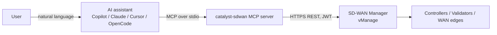

# Cisco Catalyst SD-WAN MCP Server

[](https://github.com/waqasdaar/cisco-catalyst-sdwan-mcp/actions/workflows/ci.yml)

A [Model Context Protocol (MCP)](https://modelcontextprotocol.io/) server for **Cisco Catalyst SD-WAN Manager (vManage)**. It lets AI assistants such as OpenChamber/OpenCode, GitHub Copilot in VS Code and Visual Studio, Cursor and Claude query the SD-WAN fabric in natural language: devices, control plane, OMP, BFD, routing, templates, policies, alarms and the rest of the vManage REST API.

All requests go through vManage. The server never connects to routers directly.

- **157 MCP tools** (118 listed on a read-only server, 157 with writes enabled): 153 purpose-built tools, including fabric-wide health, BFD and TLOC checks in a single call, BGP, OSPF, OSPFv3, EIGRP, multicast (IGMP, PIM, MFIB) and IPv6 monitoring and configuration (UX 2.0 features and UX 1.0 templates/policy objects), CLI add-on configuration (for example RIP/RIPng), UX 2.0 configuration, policy and topology groups (read, preview, create, change, associate devices, set variables, deploy) and feature profiles, plus 4 general tools that reach **every operation in the vManage OpenAPI spec** (4,128 operations on 26.2).
- **Lean tool list.** Write tools are listed only when `VMANAGE_ALLOW_WRITE=true`, so a read-only server offers 118 tools (under VS Code's 128-tool limit) in a ~103 KB tool list, about a third smaller than before. Assistants answer faster and spend fewer tokens on every request.
- **Read-only by default.** Operations that change configuration or state are disabled unless you enable them, and each call then needs explicit confirmation.
- **BGP, OSPF, OSPFv3 and EIGRP end to end.** Real-time neighbors, routes, interfaces, topology and LSDB; UX 2.0 feature reads and writes for SD-WAN and SD-Routing profiles; UX 1.0 feature templates (list, read, schema, create, update, delete, clone). Every BGP, OSPF and EIGRP operation in the 26.2 spec has a dedicated tool.
- **Multicast end to end.** IGMP, PIM, overlay multicast (topology, RPF, replicators, tunnels) and MFIB monitoring; UX 2.0 multicast features (read, schema, write); UX 1.0 IGMP, PIM and multicast templates. Every multicast operation in the 26.2 spec has a dedicated tool.
- **IPv6 end to end.** ND, neighbors, IPv6 routes, FIB, interface statistics, DHCPv6, NAT64, OMP IPv6 routes, IPv6 ACL and SGACL counters; UX 1.0 IPv6 prefix lists, IPv6 ACLs and device-access policies (read, preview, write); UX 2.0 IPv6 trackers and tracker groups (read, schema, write). Every IPv6 operation in the 26.2 spec has a dedicated tool.
- **CLI add-ons for everything else.** RIP and RIPng have no vManage API, so they are configured as raw IOS XE CLI. Dedicated tools find, read, create, change and delete CLI add-on features (UX 2.0) and CLI add-on templates (UX 1.0); `contains: "router rip"` finds where a protocol is configured.
- **Validated against the spec.** Calls through the general tools are checked against the OpenAPI spec published by *your* vManage before they are sent.
- **Secrets are protected.** Endpoints that issue tokens, passwords, OTPs or credentials are blocked. Session IDs and CSRF tokens are redacted from responses.
- **Fast and resilient.**
  - Logs in, loads the device list and the API spec in the background at startup, so the first question doesn't wait.
  - Uses Node's `undici` HTTP client with a pooled keep-alive connection set and one login shared across concurrent calls; the JWT is renewed in the background before it expires.
  - Combines identical concurrent requests and caps how many run against vManage at once.
  - Retries dropped connections and 429/502/503/504 with jittered backoff, honouring `Retry-After`.
  - Fails fast for 10 s after vManage proves unreachable, instead of every call waiting for a timeout.
  - Separate timeouts: real-time device queries get longer than inventory, configuration and statistics queries.
  - Caches the API spec on disk and short-lived lookups in a bounded memory cache; hostname lookups answer from the last device list while it refreshes in the background.
  - Returns compact JSON, and every list tool accepts `fields` and `filter` to return only what is needed.
  - Logs out session-cookie logins when the client disconnects, so they don't pile up against vManage's session limit.
- **Device names work everywhere.** Pass a hostname (`Branch-1`), system IP, UUID or serial number.
- **JWT authentication** (vManage 20.18.1+) with session-cookie fallback for older releases.



---

## Contents

- [What you can achieve](#what-you-can-achieve)
- [Quick start](#quick-start)
- [Versions and compatibility](#versions-and-compatibility)
- [Supported functionality](#supported-functionality)
  - [General API tools](#general-api-tools-full-vmanage-api)
  - [Dedicated tools (full reference)](#dedicated-tools)
  - [Routing protocols: BGP, OSPF, OSPFv3, EIGRP](#routing-protocols-at-a-glance)
  - [Multicast (IGMP, PIM, MFIB)](#multicast-igmp-pim-overlay-multicast-mfib-10)
  - [IPv6](#ipv6-monitoring-policy-objects-trackers-11)
  - [CLI add-ons (RIP, RIPng, other CLI)](#cli-add-ons-rip-ripng-and-other-cli--ux-20-and-ux-10-10)
- [Installation](#installation)
- [Configuration](#configuration)
- [Integrating with MCP clients](#integrating-with-mcp-clients)
  - [OpenChamber / OpenCode](#openchamber--opencode)
  - [Visual Studio Code (GitHub Copilot)](#visual-studio-code-github-copilot)
  - [Visual Studio 2022](#visual-studio-2022)
  - [Cursor](#cursor)
  - [Claude Desktop](#claude-desktop)
  - [Claude Code](#claude-code)
  - [Windsurf](#windsurf)
  - [Docker](#docker)
- [Examples](#examples)
- [Security](#security)
- [Testing and verification](#testing-and-verification)
- [Troubleshooting](#troubleshooting)
- [Project structure](#project-structure)
- [License](#license)

---

## What you can achieve

Ask questions about your SD-WAN fabric in plain language and get answers built from live Manager data, without clicking through the GUI or writing API scripts.

| Use case | Example questions | Main tools |
|---|---|---|
| **Inventory and health** | "Is my fabric healthy?" "Which edges have high CPU?" "Is the Manager a cluster or single node?" | `get_fabric_health`, `list_devices`, `list_reachable_devices` |
| **Control-plane troubleshooting** | "Why is this edge missing control connections? Show the history." | `get_control_connections`, `get_control_connections_history`, `get_control_local_properties` |
| **Overlay routing (OMP)** | "Which TLOCs and routes does this site advertise in VPN 10?" | `get_omp_routes`, `get_omp_tlocs`, `get_omp_peers` |
| **OSPF and OSPFv3** | "Is OSPF running on Branch-2? Show its OSPFv3 neighbors. Which service profiles configure OSPF?" | `get_ospf_interfaces`, `get_ospf_neighbors`, `get_ospf_config` |
| **BGP** | "Which BGP neighbors does Hub-1 have in VPN 10? Which profiles configure BGP?" | `get_bgp_neighbors`, `get_bgp_routes`, `get_bgp_config` |
| **EIGRP** | "Is EIGRP running on Branch-3? Show its topology table. Which service profiles configure EIGRP?" | `get_eigrp_interfaces`, `get_eigrp_topology`, `get_eigrp_config` |
| **Multicast** | "Which IGMP groups has Branch-1 joined? Who are its PIM neighbors and RPs? Which service profiles configure multicast?" | `get_igmp_status`, `get_pim_status`, `get_mfib`, `get_multicast_config` |
| **IPv6** | "Which IPv6 routes does Branch-1 have in VPN 10? Show its IPv6 neighbors. Which IPv6 prefix lists and ACLs exist?" | `get_ipv6_status`, `get_ipv6_policy_status`, `get_ipv6_policy_object`, `get_ipv6_tracker` |
| **RIP, RIPng and other CLI** | "Which CLI add-ons configure RIP? Add an `ipv6 router rip` block to the Branch CLI profile." | `list_cli_addons`, `list_cli_templates`, `create_cli_addon`, `update_cli_addon` |
| **Routing changes (opt-in)** | "Create a BGP feature for AS 65001 and attach it to VPN 10." "Clone the OSPF-Branch template." | `create_bgp_feature`, `associate_bgp_feature`, `update_ospf_feature`, `clone_routing_template`, ... |
| **Data plane and transport** | "Are all BFD sessions in the fabric up? How many TLOCs does site 100 have?" | `get_fabric_bfd_status`, `get_fabric_tlocs`, `get_bfd_sessions`, `get_control_wan_interfaces` |
| **Application-aware routing** | "Show tunnel loss/latency/jitter and SLA classes." | `get_app_route_statistics`, `get_app_route_sla_class` |
| **Configuration audit (UX 2.0)** | "Which configuration group configures the branch sites? What would a deploy change?" | `list_config_groups`, `get_config_group`, `preview_config_group_device_config` |
| **Configuration, policy and topology group changes (UX 2.0, opt-in)** | "Add Branch-3 to Branch-CG, set its variables, preview and deploy." | `associate_group_devices`, `update_group_variables`, `preview_config_group_device_config`, `deploy_group` |
| **Templates and policies (UX 1.0)** | "Which device templates and centralized policies are in use? Which BGP, OSPF, EIGRP or PIM templates exist?" | `list_device_templates`, `get_attached_devices`, `list_policies`, `list_routing_templates` |
| **Operations** | "Any critical alarms? Certificates expiring? Is the Manager cluster healthy?" | `list_alarms`, `get_certificate_summary`, `get_cluster_status` |
| **Anything else in the API** | "Show IPsec/IKE sessions", "audit log for today" | `search_api_operations` → `describe_api_operation` → `call_api_operation` |
| **Controlled changes (opt-in)** | Any POST/PUT/DELETE operation, only after you approve it | The routing write tools, or `call_api_operation`, with `confirm: true` and `VMANAGE_ALLOW_WRITE=true` |

---

## Quick start

```bash
# 1. Get the code and build it
git clone https://github.com/waqasdaar/cisco-catalyst-sdwan-mcp.git
cd cisco-catalyst-sdwan-mcp
npm ci && npm run build

# 2. Point it at your Manager
cp .env.example .env && chmod 600 .env
#    edit .env: VMANAGE_HOST, VMANAGE_USERNAME, VMANAGE_PASSWORD

# 3. (Optional) Smoke test with the MCP Inspector
npx @modelcontextprotocol/inspector node build/index.js
```

4. Register the server in your AI client, for example VS Code `.vscode/mcp.json`:

   ```json
   {
     "servers": {
       "catalyst-sdwan": { "type": "stdio", "command": "node", "args": ["${workspaceFolder}/build/index.js"] }
     }
   }
   ```

5. Open the chat in **Agent** mode and ask: *"How many devices are in my SD-WAN fabric?"*

See [Installation](#installation), [Configuration](#configuration) and [Integrating with MCP clients](#integrating-with-mcp-clients) for details and other clients.

---

## Versions and compatibility

| Component | Version | Notes |
|---|---|---|
| MCP server | **1.0.0** | `package.json` version, reported in the MCP `initialize` response |
| Catalyst SD-WAN Manager | **Tested on 26.2.1** | Controllers 26.2.1, WAN edges Catalyst 8000V IOS XE 26.02.01 |
| Catalyst SD-WAN Manager (auth) | 20.18.1+ for JWT | Older releases: set `VMANAGE_USE_JWT=false` (session cookie + XSRF token) |
| Node.js | 20.12+ | CI runs the offline tests on Node.js 20, 22 and 24; tested live on Node.js 26 |
| MCP TypeScript SDK | `@modelcontextprotocol/sdk` ^1.0.4 | Tested with 1.27.1 |
| Transport | stdio | The client starts the server as a child process |
| MCP clients tested | OpenChamber 2.5 (bundled OpenCode 2.0.32), OpenCode 1.19 | Other clients use their documented standard MCP config |

The four general API tools (`list_api_categories`, `search_api_operations`, `describe_api_operation`, `call_api_operation`) download the OpenAPI spec that your vManage publishes at `https://<vmanage>/apidocs/vmanageapi.json`. They therefore follow the API of whatever release you connect to, and new endpoints in later releases are available without code changes.

---

## Supported functionality

### General API tools (full vManage API)

| Tool | Purpose | Key parameters | Example prompt |
|---|---|---|---|
| `list_api_categories` | Lists the API categories (390 on 26.2) with counts of read, write and blocked operations | `filter` | "Which API categories exist for monitoring?" |
| `search_api_operations` | Finds operations by keywords matched against path, operationId, category and summary | `query`, `category`, `method` (`GET`/`POST`/`PUT`/`DELETE`), `access` (`read`/`write`/`blocked`), `limit` (default 25, max 100) | "Find the API for OSPF neighbors." |
| `describe_api_operation` | Shows an operation's documented parameters, request-body schema/example and access level | `operation_id`\* | "What parameters does `createOSPFNeighbors` take?" |
| `call_api_operation` | Calls any operation; parameters and body are validated against the spec | `operation_id`\*, `path_params`, `query`, `body`, `confirm`, `max_items` (default 200), `all_pages` | "Show OSPF neighbors on Branch-1." |

Each of the 4,128 operations in the 26.2 spec falls into one of three access levels:

| Access | Count on 26.2 | Behaviour |
|---|---|---|
| **read** | 2,392 | Runs immediately |
| **write** | 1,672 | Disabled unless `VMANAGE_ALLOW_WRITE=true`; then each call also needs `confirm: true` |
| **blocked** | 64 | Never callable: issues or exposes tokens, passwords, OTPs, credentials or bootstrap configs; file uploads; event streams |

Operations count as **write** when their method is POST, PUT or DELETE, or when their operationId or spec description describes an action. Examples: `setvSmartMtHubList` (pushes the serial list to controllers), `reTriggerNetworkMigration`, telemetry opt-in. vManage has several GET endpoints like these that change state.

### Dedicated tools

Parameters marked `*` are required; all others are optional. Every `device_id` / `device` parameter accepts a **hostname** (e.g. `Branch-1`), **system IP**, UUID or serial number. Real-time device tools query the device through the Manager; tools with `synced` can return the Manager's cached copy instead, which is faster.

**Response shaping (all tools except the API catalog and fabric-wide tools).** Optional arguments trim list results before they reach the assistant, which means fewer tokens and faster answers:

| Argument | Example | Effect |
|---|---|---|
| `fields` | `["host-name", "system-ip", "reachability"]` | Keep only these fields in each row |
| `filter` | `{ "reachability": "unreachable" }` or `{ "color": ["mpls", "private1"] }` | Keep only matching rows (case-insensitive; an array matches any value). The response includes `selection: { matched, of }`. |
| `count_by` | `"reachability"`, `"device-model"`, `"version"` | Return counts per value instead of rows (after `filter`). Summarizes thousands of rows in a few lines. |
| `offset` / `limit` | `0` / `100` | Page through rows (after `filter`). The response includes `page: { offset, returned, total, nextOffset }`. |

Responses stay under 200,000 characters. A larger list is cut at a row boundary and returns `truncated: { returned, total, nextOffset }`; calling again with `offset` set to `nextOffset` continues the list. `list_devices` reads a cached inventory (60 s), which is also preloaded at startup, and returns summary fields unless `fields` or `all_fields: true` is given.

```json
{ "name": "list_devices", "arguments": { "fields": ["host-name", "system-ip"], "filter": { "device-type": "vedge" } } }
```

#### Fabric-wide (3)

One call answers a fabric-wide question. The server queries every selected WAN edge in parallel and returns a summary plus per-device detail, instead of the assistant calling a per-device tool once per edge. Unreachable edges are listed under `skippedUnreachable` rather than queried, and a device that fails is reported with an `error` without failing the whole call.

Built for large overlays:

- **Bounded fan-out.** A fixed pool of workers (`VMANAGE_FABRIC_CONCURRENCY`, default 6) leaves request slots free for other tools. Real-time sweeps use a smaller pool (`VMANAGE_FABRIC_REALTIME_CONCURRENCY`, default 4) and are capped at 200 edges.
- **Time budget.** A sweep returns within `VMANAGE_FABRIC_DEADLINE_MS` (default 25 s), or `max_wait_seconds` per call. Edges not reached in time are listed under `incomplete`.
- **Resumable.** Per-device results are cached (60 s synced, 15 s real-time), so calling again continues with only the remaining edges.
- **Overload breaker.** After 5 consecutive overload errors (429/5xx/timeouts), the sweep stops instead of adding load to the Manager.
- **Compact output.** Above 50 edges only devices with problems or errors are listed (`detail: "all"` lists every device); summary totals always cover all queried edges.

| Tool | Description | Key parameters | Example prompt |
|---|---|---|---|
| `get_fabric_health` | Overall `status` (`healthy`/`degraded`) with a plain-language `issues` list; Manager deployment (single node or cluster, single- or multi-tenant, provider or tenant view) with node state and services down; a table of every device (system IP, site, reachability, health with CPU/memory, up/total control connections, OMP peers, BFD sessions and TLOCs, problems); fabric totals; active alarms by severity and certificate status | `detail` (`auto`/`all`/`problems`) | "Is my SD-WAN fabric healthy?" |
| `get_fabric_bfd_status` | BFD sessions of every WAN edge: per-device counts, the sessions that are not up, and fabric totals | `site_id`, `devices` (hostnames or system IPs), `synced` | "Are all BFD sessions in the fabric up?" |
| `get_fabric_tlocs` | TLOCs of every WAN edge: color, interface, state and IPs per device, totals per color and TLOCs that are not up | `site_id`, `devices`, `synced` | "How many TLOCs does each branch have, and are any down?" |

`get_fabric_health` takes per-device counters and health from `/health/devices` (falling back to the device inventory), not from the dashboard status widgets, which can report 0 up / 0 down. Unhealthy devices show the cause, e.g. `health red (CPU 96.4%, memory 45.5%)`. The Manager deployment comes from `/clusterManagement/tenancy/mode` and `/clusterManagement/list`; on a multi-tenant Manager in provider view the tenants are listed. Up to 50 devices are all listed; above that only devices with problems (`detail: "all"` lists every device).

The fabric BFD and TLOC tools query devices in real time when 25 or fewer edges are selected, and use vManage's cached (synced) data otherwise; `synced: true` or `false` overrides this. With synced data, results include the time the data was last synced (`syncedDataAsOf`), and edges whose cached BFD sessions are not up are re-checked in real time (`verifiedLive`) before they are reported. vManage processes many real-time device queries slowly, so combine `synced: false` with `site_id` or `devices` on large fabrics.

#### Devices and inventory (5)

| Tool | Description | Key parameters | Example prompt |
|---|---|---|---|
| `list_devices` | All fabric devices (Manager, Controllers, Validators, WAN edges) with hostname, type, system IP, site ID, reachability and version | `model` (e.g. `vedge-C8000V`, `vsmart`) | "How many devices are in the SD-WAN fabric?" |
| `get_device_details` | Full inventory record of one device | `device_id`\* | "Show details of Branch-1." |
| `list_reachable_devices` | Devices that are currently reachable | – | "Which devices are reachable right now?" |
| `list_controllers` | Manager, Controller and Validator inventory | – | "List the controllers and their versions." |
| `list_vedge_inventory` | WAN edge authorized list with certificate and validity status | – | "Which WAN edges are in the inventory but not valid?" |

#### Control plane (13)

| Tool | Description | Key parameters | Example prompt |
|---|---|---|---|
| `get_control_connections` | Control connections of a device to Controllers, Validator and Manager | `device_id`\*, `peer_type` (`vedge`/`vsmart`/`vmanage`/`vbond`), `system_ip`, `synced` | "Show Branch-1's control connections to the vSmarts." |
| `get_control_connections_history` | Past connection attempts, errors and down reasons | `device_id`\* | "Why did Branch-2 lose its control connections?" |
| `get_control_local_properties` | System IP, site ID, organization, certificate state, Validator address, max controllers | `device_id`\*, `synced` | "What org name and certificate state does Hub-1 have?" |
| `get_control_wan_interfaces` | Per-TLOC control state: color, interface, public/private IP and port, controller counts | `device_id`\*, `synced` | "How many TLOCs does Branch-1 have?" |
| `get_control_valid_devices` | Authorized device lists held by a Controller (vSmart) | `device_id`\* (controller), `list` (`devices`/`vsmarts`/`vmanage_id`) | "Which edges are authorized on the first Controller?" |
| `get_control_affinity` | Controller-group affinity configuration or status | `device_id`\*, `type` (`config`/`status`) | "Show controller affinity status of Hub-1." |
| `get_control_links` | Fabric-wide control links in a given state | `state`\* (`up`/`down`) | "List all control links that are down." |
| `get_control_status` | Fabric-wide control up/down counts | – | "How many control connections are up vs. down?" |
| `get_control_count` | Control connection counts, fabric-wide or per site | `site_id` | "Control connection count for site 103." |
| `get_control_network_summary` | Per device: control connections, OMP peers, vSmart peers, reachability | `state` (`up`/`down`) | "Give me a fabric-wide control-plane summary." |
| `get_network_connections_summary` | Reachable/unreachable counts per device class | – | "How many WAN edges are unreachable?" |
| `get_control_summary` | Control-plane summary of a device | `device_id`\* | "Control summary of Branch-3." |
| `get_control_statistics` | DTLS control connection statistics | `device_id`\* | "Show DTLS statistics of Branch-1." |

#### OMP – Overlay Management Protocol (9)

| Tool | Description | Key parameters | Example prompt |
|---|---|---|---|
| `get_omp_peers` | OMP peers of a device | `device_id`\*, `synced` | "Show the OMP peers of the first Controller." |
| `get_omp_routes` | OMP routes received or advertised | `device_id`\*, `direction` (`received`/`advertised`), `vpn_id`, `prefix` | "Show OMP routes Branch-1 receives in VPN 10." |
| `get_omp_tlocs` | OMP TLOC routes received or advertised | `device_id`\*, `direction`, `color` | "Which TLOCs does Branch-1 advertise?" |
| `get_omp_services` | OMP service routes (VPN, firewall, IDS, ...) | `device_id`\* | "Which OMP services does Hub-1 know?" |
| `get_omp_multicast` | Multicast routes or auto-discovery entries | `device_id`\*, `type` (`routes`/`autodiscover`), `direction` | "Show multicast auto-discovery on Branch-2." |
| `get_omp_cloudx` | Cloud OnRamp (CloudExpress) OMP routes | `device_id`\* | "Any Cloud OnRamp routes on Hub-1?" |
| `get_omp_links` | Fabric-wide OMP peering links in a given state | `state`\* (`up`/`down`) | "List OMP peerings that are down." |
| `get_omp_status` | Fabric-wide OMP up/down counts | – | "Are all OMP peerings up?" |
| `get_omp_summary` | OMP summary of a device | `device_id`\* | "OMP summary of Branch-3." |

#### Validator – vBond / orchestrator (6)

Use the Validator's system IP or hostname as `device_id`.

| Tool | Description | Key parameters | Example prompt |
|---|---|---|---|
| `get_validator_connections` | Current connections on the Validator, or history | `device_id`\*, `history` | "Show the Validator's connection history." |
| `get_validator_summary` | Validator connection summary | `device_id`\* | "Validator connection summary." |
| `get_validator_statistics` | DTLS/control packet statistics | `device_id`\* | "Show Validator packet statistics." |
| `get_validator_local_properties` | Organization, certificate state, system IP | `device_id`\* | "Which organization name is the Validator using?" |
| `get_validator_valid_devices` | Authorized device lists on the Validator | `device_id`\*, `list` (`vedges`/`vsmarts`/`vmanage_id`) | "How many WAN edges are authorized on the Validator?" |
| `get_validator_proxy_mapping` | NAT/proxy mapping table | `device_id`\* | "Show the Validator NAT mapping table." |

#### Data plane, interfaces, routing and system (9)

| Tool | Description | Key parameters | Example prompt |
|---|---|---|---|
| `get_bfd_sessions` | BFD sessions (tunnels) of a device | `device_id`\*, `synced` | "Are all BFD sessions on Branch-1 up?" |
| `get_bfd_summary` | BFD session summary | `device_id`\* | "BFD summary of Branch-2." |
| `get_bfd_tloc` | BFD session summary per TLOC | `device_id`\* | "BFD sessions per TLOC color on Branch-3." |
| `get_device_tloc` | TLOC information of a device | `device_id`\* | "Show TLOCs of Branch-1." |
| `get_device_vpn` | VPN configuration of a device | `device_id`\* | "Which VPNs are configured on Hub-2?" |
| `get_bridge_table` | Bridge forwarding table | `device_id`\* | "Show the bridge table of Branch-2." |
| `get_device_interfaces` | Interface status and configuration | `device_id`\*, `synced` | "Which interfaces are down on Branch-3?" |
| `get_device_arp` | ARP table (IPv4 to MAC) | `device_id`\* | "Show the ARP table of Hub-1." |
| `get_system_status` | CPU, memory, uptime | `device_id`\*, `synced` | "What's the CPU and memory usage on Hub-1?" |

#### Routing protocols at a glance

Every BGP, OSPF, OSPFv3 and EIGRP operation in the 26.2 spec has a dedicated tool. `npm test` checks this against the spec on every run.

| Area | BGP | OSPF (v2) | OSPFv3 (IPv4 and IPv6) | EIGRP |
|---|---|---|---|---|
| Real-time monitoring | `get_bgp_neighbors`, `get_bgp_routes`, `get_bgp_summary` | `get_ospf_process`, `get_ospf_neighbors`, `get_ospf_interfaces`, `get_ospf_routes`, `get_ospf_database` | `get_ospf_neighbors` / `get_ospf_interfaces` with `version: "ospfv3"` | `get_eigrp_interfaces`, `get_eigrp_routes`, `get_eigrp_topology` |
| UX 2.0 features: read | `get_bgp_config`, `get_bgp_feature_schema` | `get_ospf_config` | `get_ospf_config` with `version: "ospfv3-ipv4"` / `"ospfv3-ipv6"` | `get_eigrp_config` (service profiles) |
| UX 2.0 features: write | `create_bgp_feature`, `associate_bgp_feature`, `update_bgp_feature`, `delete_bgp_feature` | `create_ospf_feature`, `associate_ospf_feature`, `update_ospf_feature`, `delete_ospf_feature` | Same OSPF tools with `version: "ospfv3-ipv4"` / `"ospfv3-ipv6"` | `create_eigrp_feature`, `associate_eigrp_feature`, `update_eigrp_feature`, `delete_eigrp_feature` |
| UX 1.0 templates | `cisco_bgp`, `bgp` | `cisco_ospf`, `ospf` | `cisco_ospfv3` | `eigrp` |
| Spec operations covered | 55 (25 read, 30 write) | 144 including OSPFv3 (63 read, 81 write) | 92 of the 144 (38 read, 54 write) | 23 (11 read, 12 write) |

The UX 1.0 rows use the [routing and multicast template tools](#routing-and-multicast-feature-templates--ux-10-7), which work on all routing and multicast template types.

**RIP and RIPng** have no API in vManage 26.2: no `/device/rip` monitoring, no UX 2.0 routing feature and no UX 1.0 template type. They are configured as IOS XE CLI through [CLI add-ons](#cli-add-ons-rip-ripng-and-other-cli--ux-20-and-ux-10-10).

UX 2.0 configuration tools address a feature by profile, never by raw URL:

- `profile_type` (`service` or `transport`) and `profile` (ID or exact name) pick the feature profile; `solution` picks `sdwan` (default) or `sd-routing`.
- `vpn_feature_id` narrows to the features associated with one VPN feature (SD-WAN: LAN VPN for service, WAN VPN for transport) or VRF feature (SD-Routing). `global_vrf: true` selects the global VRF of an SD-Routing transport profile.
- `feature_id` addresses one feature. All IDs must be UUIDs.

**Typical write workflow** (needs `VMANAGE_ALLOW_WRITE=true`; every write needs `confirm: true` after you approve it):

1. Read the current state: `get_bgp_config` / `get_ospf_config`, and `get_bgp_feature_schema` for the body format.
2. Create the feature in the profile: `create_bgp_feature` / `create_ospf_feature` returns its ID.
3. Attach it to a VPN or VRF: `associate_bgp_feature` / `associate_ospf_feature`.
4. Deploy the configuration group (`preview_config_group_device_config` shows what would change first). Editing a profile never pushes configuration to devices by itself.

To remove a feature, first detach it (`delete_*_feature` with `vpn_feature_id`), then delete it (`delete_*_feature` without `vpn_feature_id`).

#### BGP (9)

The nine tools cover all 55 BGP operations in the 26.2 spec: the 3 real-time monitoring endpoints (with their filters), the 2 feature-schema reads, and the 20 read and 30 write operations for BGP features of SD-WAN and SD-Routing feature profiles. The write tools follow the same rules as the OSPF write tools below.

| Tool | Description | Key parameters | Example prompt |
|---|---|---|---|
| `get_bgp_neighbors` | BGP neighbors | `device_id`\*, `vpn_id`, `peer_addr`, `as` | "Show BGP neighbors on Hub-1 in VPN 10." |
| `get_bgp_routes` | BGP routes | `device_id`\*, `vpn_id`, `prefix`, `nexthop` | "Which BGP routes does Hub-2 have for 10.1.0.0/16?" |
| `get_bgp_summary` | BGP summary | `device_id`\* | "BGP summary of Hub-1." |
| `get_bgp_config` | BGP features of a UX 2.0 service or transport profile, optionally per VPN/VRF feature or one feature | `profile_type`\*, `profile`\*, `solution` (`sdwan`/`sd-routing`), `vpn_feature_id`, `global_vrf`, `feature_id` | "Which BGP features does the Hub-Transport profile have?" |
| `get_bgp_feature_schema` | JSON schema vManage expects for an SD-WAN BGP feature body | `profile_type`\*, `schema_type` (`post` default/`put`) | "What fields does a BGP service feature need?" |
| `create_bgp_feature` | **Write.** Create a BGP feature in a profile; returns its ID | `profile_type`\*, `profile`\*, `body`\*, `confirm`\*, `solution`, `global_vrf` | "Create a BGP AS 65001 feature in Branch-Service." |
| `update_bgp_feature` | **Write.** Replace a feature (full definition); with `vpn_feature_id`, edits its VPN/VRF association | `profile_type`\*, `profile`\*, `feature_id`\*, `body`\*, `confirm`\*, `vpn_feature_id` | "Add a neighbor to the BGP feature in Branch-Service." |
| `delete_bgp_feature` | **Write.** Delete a feature; with `vpn_feature_id`, only removes its association with that VPN/VRF | `profile_type`\*, `profile`\*, `feature_id`\*, `confirm`\*, `vpn_feature_id` | "Detach the BGP feature from VPN 10." |
| `associate_bgp_feature` | **Write.** Attach an existing feature to a VPN feature (sdwan) or VRF feature (sd-routing) | `profile_type`\*, `profile`\*, `vpn_feature_id`\*, `feature_id`\*, `confirm`\*, `global_vrf` | "Attach the BGP feature to the VPN 10 feature." |

#### OSPF and OSPFv3 (10)

The ten tools cover all 144 OSPF operations in the 26.2 spec, 92 of them OSPFv3: the 9 real-time monitoring endpoints, and the 54 read and 81 write operations for OSPF / OSPFv3 features of SD-WAN and SD-Routing feature profiles. OSPFv3 is selected with `version`: `ospfv3` for the monitoring tools, `ospfv3-ipv4` or `ospfv3-ipv6` for the feature tools.

The four write tools change configuration. Like `call_api_operation`, they are disabled unless `VMANAGE_ALLOW_WRITE=true`, each call needs `confirm: true` after you approve it, and the target operation is checked against the Manager's spec before it is sent. Changing a feature in a profile does not deploy it; devices get the change when their configuration group is deployed.

| Tool | Description | Key parameters | Example prompt |
|---|---|---|---|
| `get_ospf_process` | OSPF process details. Can be empty even when OSPF runs in a service VPN; use `get_ospf_interfaces` to confirm OSPF is enabled | `device_id`\* | "Show the OSPF process on Hub-1." |
| `get_ospf_neighbors` | OSPF or OSPFv3 neighbors | `device_id`\*, `version` (`ospfv2` default/`ospfv3`) | "Show OSPF neighbors on Hub-1." |
| `get_ospf_interfaces` | OSPF or OSPFv3 enabled interfaces (with area, VPN, state) | `device_id`\*, `version` | "Is OSPF configured on Branch-2?" |
| `get_ospf_routes` | OSPF routes | `device_id`\* | "Show OSPF routes on Hub-2." |
| `get_ospf_database` | Link-state database | `device_id`\*, `view` (`summary` default/`full`/`external`) | "Show external LSAs on Hub-1." |
| `get_ospf_config` | OSPF / OSPFv3 features of a UX 2.0 service or transport profile, optionally per VPN/VRF feature or one feature | `profile_type`\* (`service`/`transport`), `profile`\*, `solution` (`sdwan`/`sd-routing`), `version` (`ospf`/`ospfv3-ipv4`/`ospfv3-ipv6`), `vpn_feature_id`, `global_vrf`, `feature_id` | "Which OSPF features does the Branch-Service profile have?" |
| `create_ospf_feature` | **Write.** Create an OSPF / OSPFv3 feature in a profile; returns its ID | `profile_type`\*, `profile`\*, `body`\* (`{ name, description, data }`), `confirm`\*, `solution`, `version` | "Create an OSPF area 0 feature in Branch-Service." |
| `update_ospf_feature` | **Write.** Replace a feature (full definition); with `vpn_feature_id`, edits its VPN/VRF association | `profile_type`\*, `profile`\*, `feature_id`\*, `body`\*, `confirm`\*, `vpn_feature_id` | "Change the OSPF hello interval in Branch-Service to 5 s." |
| `delete_ospf_feature` | **Write.** Delete a feature; with `vpn_feature_id`, only removes its association with that VPN/VRF | `profile_type`\*, `profile`\*, `feature_id`\*, `confirm`\*, `vpn_feature_id` | "Detach the OSPF feature from VPN 10 in Branch-Service." |
| `associate_ospf_feature` | **Write.** Attach an existing feature to a VPN feature (sdwan) or VRF feature (sd-routing) | `profile_type`\*, `profile`\*, `vpn_feature_id`\*, `feature_id`\*, `confirm`\*, `global_vrf` | "Attach the OSPF feature to the VPN 10 feature." |

#### EIGRP (8)

The eight tools cover all 23 EIGRP operations in the 26.2 spec: the 3 real-time monitoring endpoints and the 8 read and 12 write operations for EIGRP features. vManage has EIGRP features only in **service** profiles (SD-WAN: profile level and per LAN VPN; SD-Routing: profile level and per VRF), so `profile_type` accepts only `service`. The write tools follow the same rules as the OSPF write tools above.

| Tool | Description | Key parameters | Example prompt |
|---|---|---|---|
| `get_eigrp_interfaces` | EIGRP-enabled interfaces; an empty list means EIGRP is not running | `device_id`\* | "Is EIGRP running on Branch-3?" |
| `get_eigrp_routes` | EIGRP routes | `device_id`\* | "Show EIGRP routes on Branch-3." |
| `get_eigrp_topology` | EIGRP topology table (successors and feasible successors) | `device_id`\* | "Does Branch-3 have a feasible successor for 10.20.0.0/16?" |
| `get_eigrp_config` | EIGRP features of a UX 2.0 service profile, optionally per VPN/VRF feature or one feature | `profile_type`\* (`service`), `profile`\*, `solution` (`sdwan`/`sd-routing`), `vpn_feature_id`, `feature_id` | "Which EIGRP features does the Branch-Service profile have?" |
| `create_eigrp_feature` | **Write.** Create an EIGRP feature in a service profile; returns its ID | `profile_type`\*, `profile`\*, `body`\*, `confirm`\*, `solution` | "Create an EIGRP AS 100 feature in Branch-Service." |
| `update_eigrp_feature` | **Write.** Replace a feature (full definition); with `vpn_feature_id`, edits its VPN/VRF association | `profile_type`\*, `profile`\*, `feature_id`\*, `body`\*, `confirm`\*, `vpn_feature_id` | "Add network 10.30.0.0/16 to the EIGRP feature." |
| `delete_eigrp_feature` | **Write.** Delete a feature; with `vpn_feature_id`, only removes its association with that VPN/VRF | `profile_type`\*, `profile`\*, `feature_id`\*, `confirm`\*, `vpn_feature_id` | "Detach the EIGRP feature from VPN 20." |
| `associate_eigrp_feature` | **Write.** Attach an existing feature to a LAN VPN feature (sdwan) or VRF feature (sd-routing) | `profile_type`\*, `profile`\*, `vpn_feature_id`\*, `feature_id`\*, `confirm`\* | "Attach the EIGRP feature to the VPN 20 feature." |

#### Application-aware routing, flows and statistics (7)

| Tool | Description | Key parameters | Example prompt |
|---|---|---|---|
| `get_app_route_statistics` | AAR tunnel statistics (loss, latency, jitter) | `device_id`\* | "Show tunnel loss and latency on Branch-1." |
| `get_app_route_sla_class` | SLA classes used by application-aware routing | `device_id`\* | "Which SLA classes are configured on Branch-1?" |
| `get_cflowd_flows` | cFlowd flow records | `device_id`\* | "Show cFlowd flows on Branch-3." |
| `get_cflowd_statistics` | cFlowd packet statistics | `device_id`\* | "cFlowd statistics of Branch-3." |
| `get_app_log_flows` | Packet flow logs | `device_id`\* | "Show logged flows on Branch-2." |
| `get_app_log_flow_count` | Number of logged flows | `device_id`\* | "How many flows are being logged on Branch-2?" |
| `get_sdwan_stats` | SD-WAN statistics: ACL drops, data policy, device metrics | `device_id`\* | "Any data-policy drops on Branch-2?" |

#### UX 2.0 configuration (21)

The `solution` parameter selects `sdwan` (default), `sd-routing`, `nfvirtual` or `mobility`. Groups and profiles can be passed by ID or exact name, and devices by hostname, system IP, UUID or chassis number. The dedicated tools cover all 40 configuration-group, policy-group and topology-group operations of the 26.2 spec.

| Tool | Description | Key parameters | Example prompt |
|---|---|---|---|
| `get_ux2_overview` | One-call summary: configuration, policy and topology groups with device counts and deployment state, plus feature-profile counts per type | `solution` | "Are any configuration groups out of sync or failed?" |
| `list_config_groups` | Configuration groups with feature profiles, device counts and deployment state | `solution`, `name` | "How many configuration groups are on vManage?" |
| `get_config_group` | One configuration group with its profiles and associated devices | `config_group`\* | "Which devices does configuration group Branch-CG configure?" |
| `get_config_group_device_variables` | Device-specific variable values (all devices or one) | `config_group`\*, `device` | "Show the variables of Branch-1 in Branch-CG." |
| `preview_config_group_device_config` | **Read-only** preview: configuration the group would push vs. running config. Nothing is deployed. | `config_group`\*, `device`\*, `view` (`diff` default/`new`/`existing`/`both`) | "What would Branch-CG change on Branch-1 if I deployed now?" |
| `list_policy_groups` | Policy groups with profiles, device counts and state | `solution` | "List the policy groups." |
| `get_policy_group` | One policy group with profiles and devices | `policy_group`\* | "Which devices use policy group Branch-PG?" |
| `list_topology_groups` | Topology groups (hub-and-spoke, mesh) | `solution` | "Which topology groups exist?" |
| `get_topology_group` | One topology group with its profiles | `topology_group`\* | "Show topology group Hub-Spoke." |
| `list_feature_profiles` | Feature profiles per type (`system`, `transport`, `service`, `cli`, `policy-object`, `application-priority`, ...) | `solution`, `profile_type` | "List all transport profiles." |
| `get_feature_profile` | One profile with its features (parcels) | `profile_type`\*, `profile`\*, `solution` | "Show the features in the Hub-Transport profile." |
| `get_network_hierarchy` | Global, regions, areas and sites | – | "Show the network hierarchy." |
| `get_group_variables` | Device variables of a configuration or policy group: values (all devices or one, optionally with suggestions), the variables schema, or a vManage-side fetch | `group_type`\* (`config`/`policy`), `group`\*, `device`, `schema`, `suggestions`, `fetch_body` | "Which variables does EMEA-Policy-Group need per device?" |
| `get_group_rules` | Automatic device-association rules of a configuration or policy group; bulk rule-association preview of a topology group | `group_type`\* (`config`/`policy`/`topology`), `group`\* | "Which rules add devices to Branch-CG?" |
| `preview_group_device_config` | **Read-only** preview for a policy or topology group: configuration it would push vs. running config. Nothing is deployed. | `group_type`\* (`policy`/`topology`), `group`\*, `device`\*, `view` (`diff` default/`new`/`existing`/`both`) | "What would EMEA-Policy-Group change on EMEA-Paris?" |
| `create_group` | **Write.** Create a configuration, policy or topology group; returns its ID | `group_type`\*, `body`\* (`{ name, description, solution, profiles: [{ id }] }`), `confirm`\* | "Create configuration group Lab-CG with the Lab profiles." |
| `update_group` | **Write.** Replace a group definition (name, description, profiles). Devices change only on deploy. | `group_type`\*, `group`\*, `body`\*, `confirm`\* | "Add the CLI profile to Branch-CG." |
| `delete_group` | **Write.** Delete a group; optionally its feature profiles too (configuration and policy groups) | `group_type`\*, `group`\*, `delete_profiles`, `confirm`\* | "Delete the unused Lab-CG." |
| `associate_group_devices` | **Write.** Add, replace or remove the devices of a configuration or policy group | `group_type`\* (`config`/`policy`), `group`\*, `devices`\*, `mode` (`add` default/`replace`/`remove`), `confirm`\* | "Add Branch-3 to Branch-CG." |
| `update_group_variables` | **Write.** Set device variable values of a configuration or policy group | `group_type`\* (`config`/`policy`), `group`\*, `body`\*, `confirm`\* | "Set the site ID variable of Branch-3 to 300." |
| `deploy_group` | **Write. Pushes configuration to devices.** Deploy a configuration, policy or topology group to the given devices; returns the vManage task | `group_type`\*, `group`\*, `devices`\*, `confirm`\* | "Deploy Branch-CG to Branch-3." |

Recommended change workflow: `get_config_group` / `get_group_variables` → change with `update_group`, `associate_group_devices` or `update_group_variables` → `preview_config_group_device_config` or `preview_group_device_config` for each device → `deploy_group` after you approve the diff.

#### Templates and policy – UX 1.0 (7)

| Tool | Description | Key parameters | Example prompt |
|---|---|---|---|
| `list_device_templates` | Device (master) templates | `feature` (`all`/`lawful-interception`/`cloud-dock`/`network-design`/`vmanage-default`) | "List the device templates." |
| `list_feature_templates` | Feature templates | – | "How many feature templates exist?" |
| `get_attached_devices` | Devices attached to a device template | `template_id`\* | "Which devices use template X?" |
| `get_template_definition` | Definition of a device or feature template | `template_id`\*, `template_type`\* (`device`/`feature`) | "Show the definition of device template X." |
| `list_policy_lists` | Policy lists (app, color, prefix, site, SLA, TLOC, VPN, ...) | `list_type` | "Show all site lists." |
| `list_policy_definitions` | Policy definitions of one type | `definition_type`\* (`acl`, `approute`, `control`, `data`, `hubandspoke`, `mesh`, `qosmap`, `zonebasedfw`, ...) | "List the app-route policy definitions." |
| `list_policies` | Centralized (vSmart), localized (vEdge) and security policies | `policy_type` (`vsmart`/`vedge`/`security`) | "Which centralized policy is active?" |

#### Routing and multicast feature templates – UX 1.0 (7)

These tools only act on the routing and multicast template types: `cisco_bgp`, `cisco_ospf`, `cisco_ospfv3`, `eigrp`, `cedge_igmp`, `cedge_pim`, `cedge_multicast` (IOS XE) and `bgp`, `ospf`, `igmp`, `pim`, `multicast` (vEdge); other templates are refused. The write tools follow the same rules as the UX 2.0 write tools. Changing a template does not reconfigure devices until their device templates are pushed again, and vManage refuses to delete a template that a device template still uses.

| Tool | Description | Key parameters | Example prompt |
|---|---|---|---|
| `list_routing_templates` | Routing and multicast feature templates with attached device counts | `protocol` (`all` default/`bgp`/`ospf`/`ospfv3`/`eigrp`/`igmp`/`pim`/`multicast`) | "Which OSPF feature templates exist?" |
| `get_routing_template` | One template's definition and the device templates using it | `template_id`\* | "Show the BGP-Hub template and where it is used." |
| `get_routing_template_schema` | Field definition of a routing template type | `template_type`\*, `version` (default `15.0.0`) | "What fields does a Cisco OSPFv3 template have?" |
| `create_routing_template` | **Write.** Create a routing feature template | `body`\* (`templateName`, `templateDescription`, `templateType`, `deviceType`, `templateMinVersion`, `templateDefinition`, `factoryDefault`), `confirm`\* | "Create a Cisco BGP template for AS 65001." |
| `update_routing_template` | **Write.** Replace a routing template (type cannot change) | `template_id`\*, `body`\*, `confirm`\* | "Change the hello interval in the OSPF-Branch template." |
| `delete_routing_template` | **Write.** Delete a routing template | `template_id`\*, `confirm`\* | "Delete the unused BGP-Lab template." |
| `clone_routing_template` | **Write.** Copy a routing template under a new name; returns the new ID (not attached anywhere) | `template_id`\*, `name`\*, `description`, `confirm`\* | "Copy the BGP-Hub template as BGP-Hub-Lab." |

#### Multicast: IGMP, PIM, overlay multicast, MFIB (10)

The ten tools cover all 26 multicast operations in the 26.2 spec: 15 real-time monitoring endpoints (grouped by `view`), the multicast feature schema, and the 4 read and 6 write operations for multicast features. vManage has UX 2.0 multicast features only in **SD-WAN service** profiles (profile level and per LAN VPN), so `profile_type` accepts only `service` and `solution` only `sdwan`. UX 1.0 IGMP, PIM and multicast templates use the [routing and multicast template tools](#routing-and-multicast-feature-templates--ux-10-7). OMP multicast routes stay in `get_omp_multicast`. The write tools follow the same rules as the OSPF write tools.

| Tool | Description | Key parameters | Example prompt |
|---|---|---|---|
| `get_igmp_status` | IGMP joined groups, interfaces, statistics or summary | `device_id`\*, `view` (`groups` default/`interface`/`statistics`/`summary`) | "Which multicast groups have receivers behind Branch-1?" |
| `get_pim_status` | PIM neighbors, interfaces, RP mappings or statistics | `device_id`\*, `view` (`neighbor` default/`interface`/`rp-mapping`/`statistics`) | "Which RP does Branch-1 use for 239.1.1.1?" |
| `get_multicast_status` | SD-WAN overlay multicast: topology, RPF, replicators or PIM tunnels | `device_id`\*, `view` (`topology` default/`rpf`/`replicator`/`tunnel`) | "Which replicator does Branch-2 use?" |
| `get_mfib` | Multicast forwarding (MFIB): summary, outgoing interface lists or statistics | `device_id`\*, `view` (`summary` default/`oil`/`stats`) | "Is multicast traffic being forwarded on Hub-1?" |
| `get_multicast_config` | Multicast features of a UX 2.0 service profile, optionally per LAN VPN feature or one feature | `profile_type`\* (`service`), `profile`\*, `vpn_feature_id`, `feature_id` | "Which multicast settings does Branch-Service configure?" |
| `get_multicast_feature_schema` | JSON schema vManage expects for a multicast feature body | `schema_type` (`post` default/`put`) | "What fields does a multicast feature have?" |
| `create_multicast_feature` | **Write.** Create a multicast feature in a service profile; returns its ID | `profile_type`\*, `profile`\*, `body`\*, `confirm`\* | "Create a multicast feature with a static RP of 10.1.1.1." |
| `update_multicast_feature` | **Write.** Replace a feature (full definition); with `vpn_feature_id`, edits its LAN VPN association | `profile_type`\*, `profile`\*, `feature_id`\*, `body`\*, `confirm`\*, `vpn_feature_id` | "Enable SPT-only in the multicast feature." |
| `delete_multicast_feature` | **Write.** Delete a feature; with `vpn_feature_id`, only removes its association with that LAN VPN | `profile_type`\*, `profile`\*, `feature_id`\*, `confirm`\*, `vpn_feature_id` | "Detach the multicast feature from VPN 10." |
| `associate_multicast_feature` | **Write.** Attach an existing feature to a LAN VPN feature | `profile_type`\*, `profile`\*, `vpn_feature_id`\*, `feature_id`\*, `confirm`\* | "Attach the multicast feature to the VPN 10 feature." |

#### IPv6: monitoring, policy objects, trackers (11)

The eleven tools cover all 83 IPv6 operations in the 26.2 spec apart from OSPFv3 (which the [OSPF tools](#ospf-and-ospfv3-10) cover): 15 real-time monitoring endpoints, 36 UX 1.0 IPv6 policy-object operations (IPv6 prefix lists, data IPv6 prefix lists, IPv6 ACL and IPv6 device-access definitions) and 32 UX 2.0 IPv6 tracker and tracker-group operations (SD-WAN transport profiles and WAN Ethernet/cellular interfaces). The write tools follow the same rules as the other write tools.

| Tool | Description | Key parameters | Example prompt |
|---|---|---|---|
| `get_ipv6_status` | IPv6 state by `view`: `nd` (default), `neighbors`, `routes`, `fib`, `interface-stats`, `dhcpv6`, `nat64`, `omp-received`, `omp-advertised`, `cflowd-flows` | `device_id`\*, `view`, `vpn_id`, `prefix`, `protocol`, `if_name`, `mac`, `tloc`, `color`, `src_addr`, `dst_addr`, `app` (each view accepts the filters it supports) | "Which IPv6 routes does Branch-1 learn over OMP in VPN 10?" |
| `get_ipv6_policy_status` | IPv6 ACL names, associations, counters, policers; SGACL IPv6 counters and permissions | `device_id`\*, `view` | "Are IPv6 ACL counters increasing on Hub-1?" |
| `get_ipv6_policy_object` | UX 1.0 IPv6 prefix lists, data IPv6 prefix lists, `aclv6` and `deviceaccesspolicyv6` definitions; list, one object, by info tag, or a read-only CLI preview | `kind`\*, `object_id`, `info_tag`, `preview`, `preview_body` | "Show the IPv6 ACLs and the CLI they render to." |
| `create_ipv6_policy_object` | **Write.** Create an IPv6 list or definition | `kind`\*, `body`\*, `confirm`\* | "Create an IPv6 prefix list with 2001:db8:10::/48." |
| `update_ipv6_policy_object` | **Write.** Replace a list or definition; `mode: multiple` or `bulk` for definitions | `kind`\*, `object_id`, `mode`, `body`\*, `confirm`\* | "Add a sequence to the IPv6 ACL." |
| `delete_ipv6_policy_object` | **Write.** Delete by ID, or every prefix list with an info tag | `kind`\*, `object_id` or `info_tag`, `confirm`\* | "Delete the lab IPv6 prefix lists." |
| `get_ipv6_tracker` | IPv6 trackers or tracker groups of a transport profile or one WAN interface, or their body schema | `profile`, `tracker_type` (`tracker`/`group`), `vpn_feature_id`, `interface_type` (`ethernet`/`cellular`), `interface_feature_id`, `tracker_id`, `schema_type` | "Which IPv6 trackers does the Transport profile use?" |
| `create_ipv6_tracker` | **Write.** Create an IPv6 tracker or tracker group | `profile`\*, `tracker_type`, `body`\*, `confirm`\* | "Create an IPv6 tracker probing 2001:db8::1." |
| `associate_ipv6_tracker` | **Write.** Attach a tracker to a WAN Ethernet or cellular interface feature | `profile`\*, `vpn_feature_id`\*, `interface_type`\*, `interface_feature_id`\*, `tracker_id`\*, `confirm`\* | "Attach the IPv6 tracker to GigabitEthernet1." |
| `update_ipv6_tracker` | **Write.** Replace a tracker; with the interface scope, edits its association | `profile`\*, `tracker_id`\*, `body`\*, `confirm`\* | "Change the IPv6 tracker interval to 30 s." |
| `delete_ipv6_tracker` | **Write.** Delete a tracker; with the interface scope, only detaches it | `profile`\*, `tracker_id`\*, `confirm`\* | "Detach the IPv6 tracker from the cellular interface." |

For IPv6 routes use `view: "routes"`: it works on every platform. IOS XE edges reject the `fib` view (`/device/ip/v6fib` is answered only by vEdge and controllers), and their `/device/ip/routetable` is empty, so `routes` reads the IETF routing list and keeps only IPv6 entries (`prefix` and `protocol` are matched by the server).

#### CLI add-ons: RIP, RIPng and other CLI – UX 2.0 and UX 1.0 (10)

CLI add-ons carry raw IOS XE configuration that is appended to a device's configuration. They are how protocols without a vManage API, such as **RIP** (`router rip`) and **RIPng** (`ipv6 router rip`), are configured. UX 2.0 keeps them as `config` features in CLI feature profiles (SD-WAN and SD-Routing; all 10 operations covered); UX 1.0 as `cli-template` feature templates.

The write tools follow the same rules as the other write tools (`VMANAGE_ALLOW_WRITE=true`, `confirm: true`, validated against the spec). Update tools change only the fields you give and keep the rest. Devices get the change when their configuration group is deployed (UX 2.0) or their device template is pushed again (UX 1.0). vManage does not check the CLI text until then, so preview it with `preview_config_group_device_config` first.

| Tool | Description | Key parameters | Example prompt |
|---|---|---|---|
| `list_cli_addons` | CLI add-on features of all CLI profiles or one, with their configuration text | `profile`, `solution` (`sdwan`/`sd-routing`), `contains` | "Which CLI add-ons configure RIP?" (`contains: "router rip"`) |
| `get_cli_addon` | One CLI add-on feature | `profile`\*, `feature_id`\*, `solution` | "Show the add-on CLI of the Branch CLI profile." |
| `create_cli_addon` | **Write.** Add a CLI add-on feature to a CLI profile | `profile`\*, `name`\*, `config`\*, `description`, `solution`, `confirm`\* | "Add RIPng on the LAN to the Branch CLI profile." |
| `update_cli_addon` | **Write.** Change a CLI add-on feature (omitted fields unchanged; `config` replaces the whole text) | `profile`\*, `feature_id`\*, `name`, `description`, `config`, `confirm`\* | "Add network 10.20.0.0 to the RIP add-on." |
| `delete_cli_addon` | **Write.** Delete a CLI add-on feature | `profile`\*, `feature_id`\*, `confirm`\* | "Remove the RIP add-on from the Branch CLI profile." |
| `list_cli_templates` | UX 1.0 CLI add-on templates (`cli-template`) | `contains` (reads each template) | "Which CLI templates contain ipv6 router rip?" |
| `get_cli_template` | One CLI template: configuration text and the device templates using it | `template_id`\* | "Show the RIP-CLI template and where it is used." |
| `create_cli_template` | **Write.** Create a CLI add-on template | `name`\*, `config`\*, `device_types`\* (e.g. `["vedge-C8000V"]`), `description`, `min_version`, `confirm`\* | "Create a CLI template with RIP version 2 for C8000V." |
| `update_cli_template` | **Write.** Change a CLI template (type and device models kept) | `template_id`\*, `name`, `description`, `config`, `confirm`\* | "Replace the config of the RIP-CLI template." |
| `delete_cli_template` | **Write.** Delete a CLI template | `template_id`\*, `confirm`\* | "Delete the unused RIP-CLI template." |

#### Cloud OnRamp, administration and applications (8)

| Tool | Description | Key parameters | Example prompt |
|---|---|---|---|
| `get_cloudx_status` | Cloud OnRamp for SaaS: sites per application | – | "Cloud OnRamp status for Office 365." |
| `get_cloudx_gateway_list` | Cloud OnRamp gateway sites | – | "Which sites are Cloud OnRamp gateways?" |
| `get_cloudx_client_list` | Cloud OnRamp client sites | – | "Which sites are Cloud OnRamp clients?" |
| `get_cloudx_apps` | Cloud OnRamp applications and VPNs | – | "Which SaaS apps are enabled for Cloud OnRamp?" |
| `list_alarms` | Active alarms | `limit` (default 100), `site_id` | "Any active alarms for site 103?" |
| `get_certificate_summary` | Certificate validity summary | – | "Are any certificates about to expire?" |
| `get_cluster_status` | Manager cluster health per node | – | "Is the vManage cluster healthy?" |
| `list_custom_apps` | Custom application definitions | – | "List the custom applications." |

Anything without a dedicated tool, such as OSPF, EIGRP, NAT, IPsec/IKE, QoS, multicast, cellular, UTD, statistics or the audit log, is available through `search_api_operations` and `call_api_operation`.

---

## Installation

Prerequisites: Node.js 20.12+, npm, and HTTPS access to Catalyst SD-WAN Manager.

```bash
git clone https://github.com/waqasdaar/cisco-catalyst-sdwan-mcp.git
cd cisco-catalyst-sdwan-mcp
npm ci
cp .env.example .env        # then edit .env (see Configuration)
npm run build
```

Check that it starts. Press `Ctrl+C` to stop it:

```bash
npm start
# stderr: Cisco Catalyst SD-WAN MCP Server running on stdio
```

The command your MCP client will run is:

```bash
node /absolute/path/to/cisco-catalyst-sdwan-mcp/build/index.js
```

### Recommended: deploy outside cloud-synced folders

If the project is in OneDrive, iCloud Drive, Dropbox or Google Drive, the sync client can move files to the cloud and the server then fails with `ETIMEDOUT` when it starts. Deploy a runtime copy instead:

```bash
npm run deploy
# Deployed to ~/mcp-servers/catalyst-sdwan-mcp
# MCP command: node ~/mcp-servers/catalyst-sdwan-mcp/build/index.js
```

`npm run deploy` builds the server and copies `build/`, `.env` (permissions `600`) and the production dependencies to `~/mcp-servers/catalyst-sdwan-mcp`. Set `CATALYST_SDWAN_MCP_HOME` to use another folder. Run it again after every code or `.env` change, then restart your MCP client.

---

## Configuration

The server reads `.env` from the project (or deployed) root folder. You can also pass the variables through your MCP client's `env` settings. Values the client sets take precedence over `.env`.

| Variable | Required | Default | Description |
|---|---|---|---|
| `VMANAGE_HOST` | Yes | | Manager hostname or IP (no `https://`) |
| `VMANAGE_USERNAME` | Yes | | API user |
| `VMANAGE_PASSWORD` | Yes | | API password |
| `VMANAGE_PORT` | No | `443` | HTTPS port |
| `VMANAGE_USE_JWT` | No | `true` | `false` uses session-cookie auth (Manager releases before 20.18.1) |
| `VMANAGE_ALLOW_WRITE` | No | `false` | `true` allows write operations through `call_api_operation` and the dedicated write tools (each call still needs `confirm: true`). The dedicated write tools (`create_*`, `update_*`, `delete_*`, `associate_*`, `clone_*`, `deploy_*`) are listed only when this is `true`. |
| `VMANAGE_TIMEOUT_MS` | No | `120000` | Timeout for real-time device queries (calls with a `deviceId`), which the Manager proxies to the device and can be slow. |
| `VMANAGE_LIST_TIMEOUT_MS` | No | `60000` | Timeout for everything else: inventory, configuration, statistics and login. |
| `VMANAGE_MAX_CONCURRENCY` | No | `8` | Maximum simultaneous requests sent to the Manager |
| `VMANAGE_FABRIC_CONCURRENCY` | No | `VMANAGE_MAX_CONCURRENCY - 2` | Parallel per-edge queries in a fabric-wide sweep (synced data) |
| `VMANAGE_FABRIC_REALTIME_CONCURRENCY` | No | `4` | Parallel per-edge queries in a real-time fabric sweep (`synced: false`) |
| `VMANAGE_FABRIC_DEADLINE_MS` | No | `25000` | Time budget of a fabric-wide sweep; edges not reached are reported under `incomplete` |
| `VMANAGE_FABRIC_MAX_DEVICES` | No | `5000` | Maximum reachable edges per synced sweep (real-time sweeps: 200) |
| `VMANAGE_LOG_TIMING` | No | `false` | `true` logs each vManage call (path, status, duration, retries, cache hits) to stderr. Never logs credentials or response data. |
| `VMANAGE_TENANT` | No | | Multi-tenant Manager with a provider account: scope every call to this tenant (name, tenant ID, org name or subdomain) |
| `VMANAGE_ALLOW_TENANT_SWITCH` | No | `false` | `true` adds a `tenant` argument to every tool so one server can query several tenants |

### Multi-tenant Managers

- **Tenant user:** set `VMANAGE_HOST` to the tenant's Manager URL and use the tenant's credentials. No other setting is needed.
- **Provider user, one tenant:** set `VMANAGE_TENANT`. The server gets a `VSessionId` for that tenant after login (`POST /tenant/{tenantId}/vsessionid`), sends it on every call, and renews it after a re-login or when the Manager rejects it.
- **Provider user, several tenants:** set `VMANAGE_ALLOW_TENANT_SWITCH=true` and pass `tenant` per call, e.g. "List unreachable devices for tenant Org A". Without `tenant`, calls use `VMANAGE_TENANT`, or the provider view if that is unset. Switching is off by default so an assistant cannot reach other tenants unless you allow it.

Cached data (device inventory, fabric results, lists) is kept per tenant, so results never cross tenants, and parallel calls for different tenants are independent. Tenant management calls (`/tenant...`) always run in the provider context.

The OpenAPI spec is cached in `~/.cache/catalyst-sdwan-mcp/` for 24 hours. If the Manager is unreachable, an older cached copy is used. Delete the file to force a refresh after an upgrade.

```dotenv
VMANAGE_HOST=vmanage.example.com
VMANAGE_USERNAME=mcp-readonly
VMANAGE_PASSWORD=change-me
VMANAGE_PORT=443
VMANAGE_USE_JWT=true
VMANAGE_ALLOW_WRITE=false
```

Use a dedicated Manager account. A read-only user group such as `operator` is enough unless you plan to enable writes.

---

## Integrating with MCP clients

In every example below, replace `/absolute/path/to/build/index.js` with your path:
- `~/mcp-servers/catalyst-sdwan-mcp/build/index.js` (expanded) if you used `npm run deploy`
- otherwise `<project>/build/index.js`

On Windows use forward slashes (`C:/mcp/catalyst-sdwan-mcp/build/index.js`) or escaped backslashes in JSON. Clients do not expand `~`, so always give the full path.

### OpenChamber / OpenCode

[OpenChamber](https://github.com/openchamber/openchamber) runs on [OpenCode](https://opencode.ai/), so MCP servers are configured in OpenCode's config. The desktop app bundles OpenCode 2.

1. Add the server to a project config (`opencode.json` in the folder you open in OpenChamber) or to the global config (`~/.config/opencode/opencode.json`).

   **OpenCode 2.x (OpenChamber 2.x)**: servers go under `mcp.servers`:

   ```json
   {
     "$schema": "https://opencode.ai/config.json",
     "mcp": {
       "servers": {
         "catalyst-sdwan": {
           "type": "local",
           "command": ["node", "/absolute/path/to/build/index.js"],
           "timeout": { "startup": 60000 }
         }
       }
     }
   }
   ```

   Or add it from the CLI. Add `--global` to make it available in every project:

   ```bash
   opencode mcp add catalyst-sdwan -- node /absolute/path/to/build/index.js
   ```

   **OpenCode 1.x**: servers go directly under `mcp` and use `enabled`:

   ```json
   {
     "$schema": "https://opencode.ai/config.json",
     "mcp": {
       "catalyst-sdwan": {
         "type": "local",
         "command": ["node", "/absolute/path/to/build/index.js"],
         "enabled": true,
         "timeout": 60000
       }
     }
   }
   ```

2. Restart OpenChamber completely (macOS: `Cmd+Q`, then reopen).
3. Verify with `/mcps` in a session, or from a terminal in the project folder. Use the OpenCode CLI that matches your OpenChamber; the desktop app's copy on macOS is:

   ```bash
   /Applications/OpenChamber.app/Contents/Resources/opencode-cli/opencode mcp list
   # ✓ catalyst-sdwan   connected
   ```

The message *"This file still uses the OpenCode 1 format"* means the config uses the 1.x layout. Move the server under `mcp.servers` as shown above.

### Visual Studio Code (GitHub Copilot)

Requires VS Code with GitHub Copilot Chat in **Agent** mode.

1. Create `.vscode/mcp.json` in your workspace for a single project, or run **MCP: Open User Configuration** from the Command Palette for all workspaces:

   ```json
   {
     "servers": {
       "catalyst-sdwan": {
         "type": "stdio",
         "command": "node",
         "args": ["/absolute/path/to/build/index.js"]
       }
     }
   }
   ```

   To keep the password out of files, let VS Code prompt for it. Values in `env` override `.env`:

   ```json
   {
     "inputs": [
       { "type": "promptString", "id": "vmanage-password", "description": "vManage password", "password": true }
     ],
     "servers": {
       "catalyst-sdwan": {
         "type": "stdio",
         "command": "node",
         "args": ["/absolute/path/to/build/index.js"],
         "env": {
           "VMANAGE_HOST": "vmanage.example.com",
           "VMANAGE_USERNAME": "mcp-readonly",
           "VMANAGE_PASSWORD": "${input:vmanage-password}"
         }
       }
     }
   }
   ```

   If the server lives in the workspace you have open, you can use a relative path. The server then reads `.env` from the project root:

   ```json
   {
     "servers": {
       "catalyst-sdwan": {
         "type": "stdio",
         "command": "node",
         "args": ["${workspaceFolder}/build/index.js"]
       }
     }
   }
   ```

   Alternatively, from a terminal:

   ```bash
   code --add-mcp '{"name":"catalyst-sdwan","command":"node","args":["/absolute/path/to/build/index.js"]}'
   ```

2. Start the server: open `mcp.json` and click **Start** above the server, or run **MCP: List Servers**.
3. In Copilot Chat, switch to **Agent** mode, open the tools picker and make sure the `catalyst-sdwan` tools are enabled.

### Visual Studio 2022

Requires Visual Studio 2022 17.14 or later with GitHub Copilot.

1. Create `.mcp.json` in your solution folder, or `%USERPROFILE%\.mcp.json` for all solutions:

   ```json
   {
     "servers": {
       "catalyst-sdwan": {
         "type": "stdio",
         "command": "node",
         "args": ["C:/mcp/catalyst-sdwan-mcp/build/index.js"]
       }
     }
   }
   ```

2. Open **GitHub Copilot Chat**, select **Agent** mode, click the tools icon and enable the `catalyst-sdwan` tools.

### Cursor

1. Edit `~/.cursor/mcp.json` (all projects) or `.cursor/mcp.json` (one project), or use **Settings → MCP → Add new MCP server**:

   ```json
   {
     "mcpServers": {
       "catalyst-sdwan": {
         "command": "node",
         "args": ["/absolute/path/to/build/index.js"]
       }
     }
   }
   ```

   Optionally add `"env": { "VMANAGE_HOST": "...", ... }` instead of using `.env`.

2. Open **Settings → MCP** and check that `catalyst-sdwan` shows a green status and lists its tools.
3. Use the tools from the Agent chat.

### Claude Desktop

1. Open **Settings → Developer → Edit Config**, or edit the file directly:
   - macOS: `~/Library/Application Support/Claude/claude_desktop_config.json`
   - Windows: `%APPDATA%\Claude\claude_desktop_config.json`

   ```json
   {
     "mcpServers": {
       "catalyst-sdwan": {
         "command": "node",
         "args": ["/absolute/path/to/build/index.js"]
       }
     }
   }
   ```

2. Restart Claude Desktop. The tools appear under the tools (hammer) icon in the chat box.

### Claude Code

```bash
claude mcp add catalyst-sdwan --scope user -- node /absolute/path/to/build/index.js
claude mcp list
```

### Windsurf

Edit `~/.codeium/windsurf/mcp_config.json`, then refresh the MCP servers in Cascade:

```json
{
  "mcpServers": {
    "catalyst-sdwan": {
      "command": "node",
      "args": ["/absolute/path/to/build/index.js"]
    }
  }
}
```

### Docker

Build the image:

```bash
docker build -t catalyst-sdwan-mcp:latest .
```

MCP clients start the container per session over stdio. Pass the settings with `--env-file`; the image never contains `.env`. Example for Cursor or Claude Desktop:

```json
{
  "mcpServers": {
    "catalyst-sdwan": {
      "command": "docker",
      "args": ["run", "-i", "--rm", "--env-file", "/absolute/path/to/.env", "catalyst-sdwan-mcp:latest"]
    }
  }
}
```

Example for VS Code (`.vscode/mcp.json`):

```json
{
  "servers": {
    "catalyst-sdwan": {
      "type": "stdio",
      "command": "docker",
      "args": ["run", "-i", "--rm", "--env-file", "/absolute/path/to/.env", "catalyst-sdwan-mcp:latest"]
    }
  }
}
```

Example for OpenCode 2.x / OpenChamber (`opencode.json`):

```json
{
  "$schema": "https://opencode.ai/config.json",
  "mcp": {
    "servers": {
      "catalyst-sdwan": {
        "type": "local",
        "command": ["docker", "run", "-i", "--rm", "--env-file", "/absolute/path/to/.env", "catalyst-sdwan-mcp:latest"]
      }
    }
  }
}
```

---

## Examples

### Sample session

Representative answers from a lab fabric (Manager 26.2.1, Catalyst 8000V edges). Names and addresses are anonymized.

**"How many devices are in the SD-WAN fabric?"** → `list_devices`

| Type | Count | Reachable |
|---|---|---|
| vManage | 1 | 1 |
| vSmart | 2 | 2 |
| vBond | 1 | 1 |
| WAN edge | 13 | 13 |

Total: 17 devices, all reachable.

**"List the total number of TLOCs on Branch-1."** → `get_control_wan_interfaces`, `get_omp_tlocs`

| Color | Interface | Encap | State |
|---|---|---|---|
| `private1` | GigabitEthernet1 | IPsec | up |
| `mpls` | GigabitEthernet2 | IPsec | up |

Total: 2 TLOCs, each advertised over OMP to both Controllers.

**"How many configuration groups are on vManage, and which one configures the branch sites?"** → `list_config_groups`, `get_config_group`

6 configuration groups. Example mapping:

| Sites | Configuration group |
|---|---|
| Hub-1, Hub-2 | Hub-CG |
| Branch-1, Branch-2 | Branch-CG (added by tag rule) |

**"Is OSPF running on Branch-1?"** → `get_ospf_interfaces` (`version: "ospfv2"` and `"ospfv3"`), `get_ospf_neighbors`

| Version | Interface | VPN | Area | Network type | State |
|---|---|---|---|---|---|
| OSPFv2 | GigabitEthernet3 | 10 | 0 | broadcast | DR |
| OSPFv3 (IPv6) | GigabitEthernet3 | 10 | 0 | point-to-point | point-to-point |

OSPF runs in service VPN 10 with one OSPFv2 neighbor on GigabitEthernet3. `get_ospf_process` returns no rows on this device, so the answer is based on interfaces and neighbors.

**"Show the BGP neighbors and routes of Branch-1, and the BGP features in its service profile."** → `get_bgp_neighbors`, `get_bgp_routes`, `get_bgp_config`

2 BGP neighbors, 16 BGP routes; the service profile contains 2 BGP features.

### Natural-language prompts

| Ask your assistant | Tools it uses |
|---|---|
| "List all SD-WAN devices with hostname, type, model, system IP, site ID, reachability and version." | `list_devices` |
| "Give me an overview of the UX 2.0 configuration: which configuration groups are out of sync or failed?" | `get_ux2_overview` |
| "Which devices are in configuration group *Branch-CG*, and what are their variable values?" | `get_config_group`, `get_config_group_device_variables` |
| "What would configuration group *Branch-CG* change on *Branch-1* if I deployed it now?" | `preview_config_group_device_config` |
| "What would policy group *EMEA-Policy-Group* change on *EMEA-Paris*?" | `preview_group_device_config` |
| "Add *Branch-3* to *Branch-CG*, set its variables, show me the diff, then deploy." *(writes enabled)* | `associate_group_devices`, `update_group_variables`, `preview_config_group_device_config`, `deploy_group` |
| "Show the features in the *Branch-Transport* transport profile." | `get_feature_profile` |
| "Which devices are unreachable, and what do their control connection histories show?" | `list_devices`, `get_control_connections_history` |
| "Show the OMP routes that Branch-1 receives in VPN 10." | `get_omp_routes` (`vpn_id: "10"`) |
| "Which TLOCs does Branch-1 advertise, and are its BFD sessions up?" | `get_omp_tlocs`, `get_bfd_sessions` |
| "Give me a fabric-wide control-plane summary: control connections and OMP peers per device." | `get_control_network_summary` |
| "How many WAN edges are authorized on the validator?" | `get_validator_valid_devices` |
| "Show OSPF neighbors on Branch-1." | `get_ospf_neighbors` |
| "Which interfaces run OSPFv3 on Branch-1, and in which area?" | `get_ospf_interfaces` (`version: "ospfv3"`) |
| "Show the external LSAs in the OSPF database of Hub-1." | `get_ospf_database` (`view: "external"`) |
| "Which BGP neighbors does Hub-1 have in VPN 10, and which routes does it learn from 198.51.100.9?" | `get_bgp_neighbors` (`vpn_id`), `get_bgp_routes` (`nexthop`) |
| "Which BGP and OSPF features does the *Branch-Service* profile contain, and which VPNs use them?" | `get_bgp_config`, `get_ospf_config` (with `vpn_feature_id`) |
| "What fields do I need to create a BGP feature in a transport profile?" | `get_bgp_feature_schema` |
| "Create a BGP feature for AS 65001 in *Branch-Service* and attach it to the VPN 10 feature." *(writes enabled)* | `create_bgp_feature`, `associate_bgp_feature` |
| "Detach the OSPFv3 IPv6 feature from VPN 10 and delete it." *(writes enabled)* | `delete_ospf_feature` (with, then without `vpn_feature_id`) |
| "Which BGP, OSPF and OSPFv3 feature templates exist, and which device templates use them?" | `list_routing_templates`, `get_routing_template` |
| "Copy the *BGP-Hub* template as *BGP-Hub-Lab*." *(writes enabled)* | `clone_routing_template` |
| "Is EIGRP running on Branch-3, and does it have feasible successors?" | `get_eigrp_interfaces`, `get_eigrp_topology` |
| "Which EIGRP features does *Branch-Service* contain, and which LAN VPNs use them?" | `get_eigrp_config` (with `vpn_feature_id`) |
| "Create an EIGRP AS 100 feature in *Branch-Service* and attach it to the VPN 20 feature." *(writes enabled)* | `create_eigrp_feature`, `associate_eigrp_feature` |
| "Which EIGRP feature templates exist, and what fields does one have?" | `list_routing_templates` (`protocol: "eigrp"`), `get_routing_template_schema` (`template_type: "eigrp"`) |
| "Which IGMP groups has Branch-1 joined, and which PIM RP does it use?" | `get_igmp_status`, `get_pim_status` (`view: "rp-mapping"`) |
| "Is multicast traffic forwarded on Hub-1, and through which replicator?" | `get_mfib` (`view: "oil"`), `get_multicast_status` (`view: "replicator"`) |
| "Create a multicast feature in *Branch-Service* and attach it to VPN 10." *(writes enabled)* | `get_multicast_feature_schema`, `create_multicast_feature`, `associate_multicast_feature` |
| "Which IPv6 routes does Branch-1 learn over OMP in VPN 10?" | `get_ipv6_status` (`view: "routes"`, `vpn_id: "10"`, `protocol: "omp"`) |
| "Show the IPv6 neighbor cache and IPv6 interface statistics of Hub-1." | `get_ipv6_status` (`view: "nd"`, then `"interface-stats"`) |
| "Which IPv6 prefix lists and IPv6 ACLs exist, and what CLI does the ACL render to?" | `get_ipv6_policy_object` (`kind`, `preview: true`) |
| "Create an IPv6 tracker and attach it to the WAN interface of the Transport profile." *(writes enabled)* | `get_ipv6_tracker` (`schema_type`), `create_ipv6_tracker`, `associate_ipv6_tracker` |
| "Is RIP or RIPng configured anywhere?" | `list_cli_addons` and `list_cli_templates` (`contains: "router rip"`) |
| "Add RIPng to the *Branch-CLI* profile, redistributing connected routes." *(writes enabled)* | `create_cli_addon` |
| "Which certificates expire soon, and are there active critical alarms?" | `get_certificate_summary`, `list_alarms` |
| "List the centralized policies and the device templates in use." | `list_policies`, `list_device_templates` |

### Tool calls (JSON arguments)

Received OMP routes in one VPN:

```json
{ "name": "get_omp_routes", "arguments": { "device_id": "Branch-1", "direction": "received", "vpn_id": "10" } }
```

Routing protocol monitoring (BGP with filters, OSPFv3, OSPF database):

```json
{ "name": "get_bgp_neighbors", "arguments": { "device_id": "Hub-1", "vpn_id": "10", "as": "65010" } }
```

```json
{ "name": "get_bgp_routes", "arguments": { "device_id": "Hub-1", "prefix": "10.1.0.0/16" } }
```

```json
{ "name": "get_ospf_neighbors", "arguments": { "device_id": "Branch-1", "version": "ospfv3" } }
```

```json
{ "name": "get_ospf_database", "arguments": { "device_id": "Hub-1", "view": "external" } }
```

```json
{ "name": "get_eigrp_topology", "arguments": { "device_id": "Branch-3" } }
```

EIGRP features exist only in service profiles; create one, then attach it to a LAN VPN feature:

```json
{
  "name": "create_eigrp_feature",
  "arguments": {
    "profile_type": "service",
    "profile": "Branch-Service",
    "body": { "name": "EIGRP-100", "description": "Branch EIGRP", "data": { "asNum": { "optionType": "global", "value": 100 } } },
    "confirm": true
  }
}
```

```json
{
  "name": "associate_eigrp_feature",
  "arguments": { "profile_type": "service", "profile": "Branch-Service", "vpn_feature_id": "<lan-vpn-feature-id>", "feature_id": "<eigrp-feature-id>", "confirm": true }
}
```

UX 2.0 routing features (read):

```json
{ "name": "get_ospf_config", "arguments": { "profile_type": "service", "profile": "Branch-Service", "version": "ospfv3-ipv6" } }
```

```json
{ "name": "get_bgp_config", "arguments": { "solution": "sd-routing", "profile_type": "transport", "profile": "WAN-Transport", "global_vrf": true } }
```

```json
{ "name": "get_bgp_feature_schema", "arguments": { "profile_type": "service", "schema_type": "post" } }
```

UX 2.0 routing features (write; `VMANAGE_ALLOW_WRITE=true` and user approval). Create the feature, then attach it to a VPN feature with the returned ID. Take the `data` fields from `get_bgp_feature_schema` or from an existing feature in `get_bgp_config`:

```json
{
  "name": "create_bgp_feature",
  "arguments": {
    "profile_type": "service",
    "profile": "Branch-Service",
    "body": { "name": "BGP-65001", "description": "Branch BGP", "data": { "asNum": { "optionType": "global", "value": 65001 } } },
    "confirm": true
  }
}
```

```json
{
  "name": "associate_bgp_feature",
  "arguments": { "profile_type": "service", "profile": "Branch-Service", "vpn_feature_id": "<lan-vpn-feature-id>", "feature_id": "<bgp-feature-id>", "confirm": true }
}
```

```json
{
  "name": "delete_ospf_feature",
  "arguments": { "profile_type": "service", "profile": "Branch-Service", "version": "ospfv3-ipv6", "vpn_feature_id": "<lan-vpn-feature-id>", "feature_id": "<ospfv3-feature-id>", "confirm": true }
}
```

IPv6 monitoring, policy objects and trackers:

```json
{ "name": "get_ipv6_status", "arguments": { "device_id": "Branch-1", "view": "routes", "vpn_id": "10", "protocol": "omp" } }
```

```json
{ "name": "get_ipv6_status", "arguments": { "device_id": "Branch-1", "view": "omp-received", "count_by": "vpn-id" } }
```

```json
{ "name": "get_ipv6_policy_object", "arguments": { "kind": "acl", "object_id": "<aclv6-definition-id>", "preview": true } }
```

```json
{
  "name": "create_ipv6_policy_object",
  "arguments": {
    "kind": "prefix-list",
    "body": { "name": "Branch-v6", "description": "Branch LAN prefixes", "entries": [{ "ipv6Prefix": "2001:db8:10::/48" }] },
    "confirm": true
  }
}
```

```json
{
  "name": "associate_ipv6_tracker",
  "arguments": {
    "profile": "Transport",
    "vpn_feature_id": "<wan-vpn-feature-id>",
    "interface_type": "ethernet",
    "interface_feature_id": "<wan-interface-feature-id>",
    "tracker_id": "<ipv6-tracker-id>",
    "confirm": true
  }
}
```

Multicast monitoring and configuration:

```json
{ "name": "get_pim_status", "arguments": { "device_id": "Branch-1", "view": "rp-mapping" } }
```

```json
{ "name": "get_mfib", "arguments": { "device_id": "Hub-1", "view": "oil" } }
```

```json
{ "name": "get_multicast_config", "arguments": { "profile_type": "service", "profile": "Branch-Service", "vpn_feature_id": "<lan-vpn-feature-id>" } }
```

CLI add-ons (RIP and RIPng have no dedicated API, so they are configured as CLI). Find where RIP is configured, then add a RIPng block to a UX 2.0 CLI profile:

```json
{ "name": "list_cli_addons", "arguments": { "contains": "router rip" } }
```

```json
{
  "name": "create_cli_addon",
  "arguments": {
    "profile": "Branch-CLI",
    "name": "RIPng-LAN",
    "description": "RIPng on LAN VPN 10",
    "config": "ipv6 router rip RIPNG\n redistribute connected\n!\ninterface GigabitEthernet3\n ipv6 rip RIPNG enable",
    "confirm": true
  }
}
```

The UX 1.0 equivalent:

```json
{
  "name": "create_cli_template",
  "arguments": { "name": "RIP-v2", "config": "router rip\n version 2\n network 10.0.0.0\n no auto-summary", "device_types": ["vedge-C8000V"], "confirm": true }
}
```

UX 1.0 routing feature templates:

```json
{ "name": "list_routing_templates", "arguments": { "protocol": "ospfv3" } }
```

```json
{ "name": "get_routing_template_schema", "arguments": { "template_type": "cisco_ospf" } }
```

```json
{ "name": "clone_routing_template", "arguments": { "template_id": "<template-id>", "name": "BGP-Hub-Lab", "description": "Lab copy", "confirm": true } }
```

```json
{
  "name": "create_routing_template",
  "arguments": {
    "body": {
      "templateName": "BGP-65001",
      "templateDescription": "Branch BGP",
      "templateType": "cisco_bgp",
      "deviceType": ["vedge-C8000V"],
      "templateMinVersion": "15.0.0",
      "templateDefinition": { },
      "factoryDefault": false
    },
    "confirm": true
  }
}
```

Fill `templateDefinition` from `get_routing_template_schema`, or start from an existing template with `clone_routing_template` and change it with `update_routing_template`.

Find an API operation, check its parameters, then call it (works for any operation, including those that also have a dedicated tool):

```json
{ "name": "search_api_operations", "arguments": { "query": "ospf neighbor" } }
```

```json
{ "name": "describe_api_operation", "arguments": { "operation_id": "createOSPFNeighbors" } }
```

```json
{ "name": "call_api_operation", "arguments": { "operation_id": "createOSPFNeighbors", "query": { "deviceId": "<system-ip>" }, "max_items": 50 } }
```

Path parameters and statistics queries:

```json
{
  "name": "call_api_operation",
  "arguments": {
    "operation_id": "getMasterTemplateDefinition",
    "path_params": { "templateId": "<template-id>" }
  }
}
```

```json
{
  "name": "call_api_operation",
  "arguments": {
    "operation_id": "postDocCount_MonitoringAlarmsDetails_1604",
    "body": { "query": { "condition": "AND", "rules": [{ "field": "entry_time", "type": "date", "operator": "last_n_hours", "value": ["24"] }] } }
  }
}
```

Operation IDs can differ between Manager releases. Use `search_api_operations` to find the ID on your release.

Statistics `.../page` operations return results in pages with a `scrollId`. `all_pages: true` keeps fetching pages until `max_items` rows are collected (up to 50 pages):

```json
{
  "name": "call_api_operation",
  "arguments": {
    "operation_id": "getPostStatBulkRawData_MonitoringApplicationAwareRouting_2504",
    "query": { "count": 100 },
    "body": { "query": { "condition": "AND", "rules": [{ "field": "entry_time", "type": "date", "operator": "last_n_hours", "value": ["1"] }] } },
    "all_pages": true,
    "max_items": 500
  }
}
```

A write operation, when `VMANAGE_ALLOW_WRITE=true`, after the user has approved it:

```json
{ "name": "call_api_operation", "arguments": { "operation_id": "<write-operation-id>", "body": { }, "confirm": true } }
```

Without `confirm: true`, or with writes disabled, the server refuses the call and explains why.

---

## Security

- **Read-only by default.** POST, PUT and DELETE operations, and GETs documented as actions, are refused unless `VMANAGE_ALLOW_WRITE=true`. Each write call then also needs `confirm: true`, which assistants should set only after the user approves. The dedicated write tools are not even listed until writes are enabled.
- **Scoped write tools.** The BGP, OSPF and routing template write tools run through the same gate as `call_api_operation`: the request is resolved to an operation in the Manager's spec and validated before it is sent. They only reach their own protocol's features or templates; IDs must be UUIDs, and a template of another type (for example `cisco_vpn`) is refused. A template's type cannot be changed by an update. Profile and template changes are never deployed to devices by these tools.
- **Blocked endpoints.** Operations that issue or expose tokens, passwords, OTPs, credentials or bootstrap configurations are never callable. Neither are file uploads or server-sent event streams.
- **Validation.** Path and query parameters must exist in the spec, required ones must be present, and types and enums are checked. Path values are URL-encoded and `.`/`..` are rejected.
- **Redaction and limits.** Values of keys such as `password`, `token`, `csrf` and `sessionId` are replaced with `***redacted***`. List responses are capped (default 200 rows, `max_items` to change) and output stays under 200,000 characters.
- **TLS.** Certificate verification is disabled so lab Managers with self-signed certificates work. Use it only on trusted networks, and treat this as a known limitation for production.
- **Credentials.** Keep `.env` out of version control (it is in `.gitignore`), restrict its permissions (`chmod 600 .env`), and use a dedicated least-privilege Manager account.
- **Access-level detection is a heuristic.** It uses the operationId and spec description. Test against a lab Manager before you enable writes on a production fabric.

---

## Testing and verification

Four test suites check the server. Only `npm test` runs without a Manager; the others call a real Manager and send **read operations only**.

| Command | Needs a Manager | What it checks | Runs in CI |
|---|---|---|---|
| `npm test` | No (simulated vManage) | 273 checks: every tool family, spec coverage of all routing/multicast/IPv6/CLI and configuration/policy/topology group operations, write protection, input validation, resilience, multi-tenancy, tool-list size | Yes: Node.js 20, 22 and 24 |
| `npm run test:control-plane -- <edge> <controller> <validator>` | Yes | 39 control-plane, OMP and Validator calls plus 3 input-validation checks | No |
| `npm run test:ux2 -- <edge-hostname>` | Yes | UX 2.0, fabric-wide, paging and response-shaping tools; hostname resolution, parallel calls, error handling, with timings | No |
| `npm run verify:api -- <edge> <controller> <validator>` | Yes (≈25 min) | Every read operation that needs no IDs (≈1,260 on 26.2) plus every dedicated read tool; writes [API_COVERAGE.md](API_COVERAGE.md) and [api_coverage.csv](api_coverage.csv) | No |

```bash
npm run build                 # compile TypeScript
npm test                      # offline tests against a simulated vManage (no lab needed; runs in CI)
# <edge>, <controller>, <validator>: hostname or system IP of a WAN edge, Controller and Validator in your fabric
npm run test:control-plane -- <edge> <controller> <validator>
npm run test:ux2 -- <edge-hostname>
npm run verify:api -- <edge> <controller> <validator>
```

### Offline tests (`npm test`)

`npm test` starts a simulated Manager on localhost (HTTPS with a throwaway certificate created by `openssl`) that serves the real 26.2.1 OpenAPI spec, and drives the real MCP server against it over stdio. GitHub Actions runs it on every push and pull request ([.github/workflows/ci.yml](.github/workflows/ci.yml)).

| Area | What is checked |
|---|---|
| Tool list | 118 tools on a read-only server with no write tool listed, 157 with `VMANAGE_ALLOW_WRITE=true`; the read-only tool list stays under 110 KB |
| Client and resilience | Hostname resolution, `Retry-After` retries on 503, re-login after an expired token, session-cookie login and logout, fail-fast when the Manager is unreachable, real-time vs. list timeouts named in the error |
| Response shaping | `fields`, `filter`, `count_by`, `offset`/`limit` paging, truncation with a `nextOffset` cursor on a 3,000-device inventory |
| Fabric-wide tools | Health table and Manager deployment detection, BFD and TLOC sweeps: concurrency cap, time budget with resume, overload breaker, synced data re-checked live |
| Multi-tenancy | Fixed tenant, per-call tenant switching, `VSessionId` reuse and renewal, cache isolation between tenants |
| API catalog | Statistics paging with `all_pages`, refusal of paging on non-paged operations, write gate on `call_api_operation` |
| Routing, multicast, IPv6 and CLI | Spec coverage (below), method/path/query/body of every request, per-view filters, read-only previews |
| Write protection | Every write tool is refused while `VMANAGE_ALLOW_WRITE=false`, and refused without `confirm: true` when writes are enabled; nothing reaches the Manager in either case |
| Input validation | Non-UUID IDs, unknown views/versions/scopes, wrong profile types and solutions, wrong template types, oversized CLI text and empty updates are rejected before any request |

#### Coverage by area

Every one of the 157 tools belongs to one area below. **Offline** is what `npm test` checks against the simulated Manager. **Live** is the suite that runs the tools against a real 26.2.1 Manager. Tools marked "run live during development" were added after the last `verify:api` report and were checked by hand against the lab.

| Area | UX | Tools | vManage APIs the tools call | Offline (`npm test`) | Live |
|---|---|---:|---|---|---|
| API catalog | – | 4 | Any of the 4,128 spec operations, validated against the spec | Statistics paging (`all_pages`), write gate, refusal of paging on non-paged operations | `test:ux2`, `verify:api` |
| Fabric-wide health, BFD and TLOCs | – | 3 | `/health/devices`, `/device`, `/device/bfd/sessions`, `/device/control/waninterface`, `/clusterManagement/*`, `/alarms`, `/certificate/stats/summary` | Health table, Manager deployment, sweeps: concurrency cap, time budget with resume, overload breaker, synced data re-checked live | `test:ux2` (cross-checked with per-device tools) |
| Devices and inventory | – | 5 | `/device`, `/device/reachable`, `/device/vedgeinventory/detail` | Hostname resolution, `fields`/`filter`/`count_by`/paging and truncation on a 3,000-device inventory | `test:ux2`, `verify:api` |
| Control plane, OMP, Validator | – | 28 | `/device/control/*`, `/device/omp/*`, `/device/orchestrator/*` | `Retry-After` retry, re-login after an expired token | `test:control-plane` (42/42) |
| Data plane, interfaces, system | – | 9 | `/device/bfd/*`, `/device/interface`, `/device/system/status`, `/device/arp`, `/device/vpn`, `/device/tloc`, `/device/bridge/table` | Real-time timeout, unknown-device rejection | `test:ux2`, `verify:api` |
| App-aware routing, flows, statistics | – | 7 | `/device/app-route/*`, `/device/cflowd/*`, `/device/app/log/*`, `/device/sdwan-stats` | – | `verify:api` |
| BGP | 2.0 | 9 | `/device/bgp/*`, `/v1/feature-profile/{sdwan,sd-routing}/{service,transport}/.../routing/bgp` | Full spec sweep (see next table) | Run live during development |
| OSPF and OSPFv3 | 2.0 | 10 | `/device/ospf/*`, `/v1/feature-profile/.../routing/{ospf,ospfv3/ipv4,ospfv3/ipv6}` | Full spec sweep | Run live during development |
| EIGRP | 2.0 | 8 | `/device/eigrp/*`, `/v1/feature-profile/.../service/.../routing/eigrp` | Full spec sweep | Run live during development |
| Multicast: IGMP, PIM, MFIB | 2.0 | 10 | `/device/{igmp,pim,multicast}/*`, `/device/ip/mfib*`, `/v1/feature-profile/sdwan/service/.../routing/multicast` | Full spec sweep | Run live during development |
| IPv6 | 1.0 and 2.0 | 11 | `/device/ipv6/*`, `/device/ip/ipRoutes`, `/template/policy/{list,definition}/*v6*`, `/v1/feature-profile/sdwan/transport/.../ipv6-tracker*` | Full spec sweep | Run live during development |
| **Configuration groups, policy groups, topology groups** | 2.0 | 18 | `/v1/config-group`, `/v1/policy-group`, `/v1/topology-group`, with `/{id}`, `/device/associate`, `/device/variables[/schema]`, `/device/deploy`, `/rules[/preview]` and `/device/{id}/preview` (read-only render) | Full spec sweep (40 operations), device-name to UUID resolution, write protection, cache invalidation after a write | `test:ux2` (9 original tools); new read tools run live during development |
| **Feature profiles and network hierarchy** | 2.0 | 3 | `/v1/feature-profile/{solution}/{type}[/{id}]`, `/v1/network-hierarchy` | Profile-name lookup (shared with the routing tools) | `test:ux2` (all 3) |
| UX 2.0 CLI add-ons | 2.0 | 5 | `/v1/feature-profile/{sdwan,sd-routing}/cli/{id}/config` | Full spec sweep | Run live during development |
| **Device and feature templates** | 1.0 | 4 | `/template/device`, `/template/feature`, `/template/device/config/attached/{id}`, `/template/{device,feature}/object/{id}` | List timeout | `verify:api` |
| **Policies, policy lists, policy definitions** | 1.0 | 3 | `/template/policy/{vsmart,vedge,security}`, `/template/policy/list/{type}`, `/template/policy/definition/{type}` | – | `verify:api` |
| Routing and multicast feature templates | 1.0 | 7 | `/template/feature` (list, object, device templates, type definition, create, update, delete, clone) | Requests, template-type guard | Run live during development |
| CLI add-on templates | 1.0 | 5 | `/template/feature` (list, object, device templates, create, update, delete) | Requests, template-type guard, `contains` search | Run live during development |
| Cloud OnRamp and administration | – | 8 | `/template/cloudx/*`, `/alarms`, `/certificate/stats/summary`, `/clusterManagement/health/status`, `/template/policy/customapp` | – | `verify:api` |
| **Total** | | **157** | | | |

Every write tool (39) is additionally checked offline for refusal while `VMANAGE_ALLOW_WRITE=false` and without `confirm: true`, and for the exact method, path and body when allowed. Live, write tools were checked only up to the write gate (writes disabled on the lab).

#### Spec sweeps

For the areas marked "Full spec sweep", the tests read every operation of the area from the published 26.2.1 spec, call every tool with every scope (solution, profile type, VPN/VRF, interface, version), and fail if an operation is never reached or a tool calls a path that is not in the spec.

OSPF and OSPFv3 share the same 10 tools; the `version` argument selects the protocol (`ospfv2`/`ospfv3` for monitoring, `ospf`/`ospfv3-ipv4`/`ospfv3-ipv6` for features). Their 144 spec operations are split into two rows so each protocol's share is visible; the two rows add up to the OSPF total.

| Area | Monitoring reads | Configuration reads | Read-only previews | Writes (POST/PUT/DELETE) | Total operations | Tools |
|---|---:|---:|---:|---:|---:|---:|
| BGP | 3 | 22 | – | 30 | 55 | 9 |
| OSPFv2 | 7 | 18 | – | 27 | 52 | 10 (shared with OSPFv3) |
| OSPFv3 (IPv4 and IPv6 address families) | 2 | 36 | – | 54 | 92 | Same 10 tools |
| EIGRP | 3 | 8 | – | 12 | 23 | 8 |
| Multicast | 15 | 5 | – | 6 | 26 | 10 |
| IPv6 (without OSPFv3) | 15 | 28 | 4 | 36 | 83 | 11 |
| UX 2.0 CLI add-ons | – | 4 | – | 6 | 10 | 5 |
| UX 2.0 configuration, policy and topology groups | – | 15 | 5 | 20 | 40 | 18 |
| **Total** | **45** | **136** | **9** | **191** | **381** | **71** |

- **Monitoring reads** are real-time device queries (`/device/...`).
- **Configuration reads** are UX 2.0 feature reads (SD-WAN and SD-Routing service/transport profiles, per VPN/VRF or interface) and UX 1.0 policy-object reads. They include the feature-schema endpoints: 2 for BGP, 1 for multicast and 2 for IPv6 trackers. IPv6 splits into 14 UX 1.0 policy-object reads and 14 UX 2.0 tracker reads.
- **Read-only previews** are POST operations that only render configuration and save nothing: `get_ipv6_policy_object` with `preview_body` (4), the configuration/policy/topology group device previews (3) and the configuration/policy group variable fetches (2). They work with writes disabled.

#### UX 1.0 template types

The UX 1.0 template tools use vManage's generic feature-template API, so a template's type decides which tool may act on it; any other type is refused:

| Tools | Template types accepted |
|---|---|
| Routing and multicast template tools (7) | IOS XE: `cisco_bgp`, `cisco_ospf`, `cisco_ospfv3`, `eigrp`, `cedge_igmp`, `cedge_pim`, `cedge_multicast`. vEdge: `bgp`, `ospf`, `igmp`, `pim`, `multicast` |
| CLI add-on template tools (5) | `cli-template` |

### Live tests

`test:control-plane` and `test:ux2` are regression tests against a lab Manager: each prints one PASS/FAIL line per call (with timings for `test:ux2`) and exits non-zero on any failure.

`verify:api` calls every read operation that needs no IDs or input through the real MCP server, then every dedicated read tool (looking up a real configuration group, profile and template first). It records each result in [API_COVERAGE.md](API_COVERAGE.md) and [api_coverage.csv](api_coverage.csv). The reports replace device IDs and sampled group, profile and template names with placeholders such as `<edge>` and `<config-group>`, so they can be published. It sends many calls, so run it against a lab Manager.

Results on Catalyst SD-WAN Manager 26.2.1:

| Item | Result |
|---|---|
| Operations in the spec | 4,128 (2,392 read / 1,672 write / 64 blocked) |
| Read operations live-tested (`verify:api`) | 1,261: 1,113 returned data, 148 errors from the Manager or lab (feature not configured, query body required, provider-only role) |
| Dedicated tools in the last `verify:api` report | 86 / 86 verified live (83 by `verify:api`, the 3 fabric-wide tools by `test:ux2`) |
| Tools added since (BGP, OSPF/OSPFv3, EIGRP, multicast, IPv6, routing templates, CLI add-ons, UX 2.0 group reads and writes) | Every read tool was run live during development; write tools were verified live only up to the write gate (writes disabled), and their requests offline. Run `verify:api` again to refresh the report. |
| `test:control-plane` | 42 / 42 passed (39 live calls + 3 input-validation checks) |
| `test:ux2` | 53 / 53 passed: UX 2.0 groups, profiles and preview, 6 parallel real-time calls, synced data, response shaping, fabric-wide sweeps cross-checked against per-device tools, error handling |

To try individual tools interactively, use the MCP Inspector:

```bash
npx @modelcontextprotocol/inspector node /absolute/path/to/build/index.js
```

Set `VMANAGE_ALLOW_WRITE=true` in the environment the Inspector passes to the server to see the write tools as well.

---

## Troubleshooting

| Symptom | Cause / fix |
|---|---|
| `ETIMEDOUT ... read` or the server hangs on start | Project is in a cloud-synced folder whose files were moved to the cloud. Run `npm run deploy` and point the client at `~/mcp-servers/catalyst-sdwan-mcp/build/index.js`. |
| `Cannot reach vManage at <host>:443 (ETIMEDOUT)` | No network path to the Manager (often a disconnected VPN). The server gives up after 10 s instead of hanging. Spec-based tools keep working from the cached spec. |
| A tool is missing or behaves like an old version | The client is starting a different copy of the server. Check every config the client reads: for OpenCode, both the project `opencode.json` and the global `~/.config/opencode/opencode.json(c)`. |
| Calls take ~2 s each | That is the Manager's own response time per request, even on a reused connection. Prefer the combined tools (`get_ux2_overview`, `list_feature_profiles`), which run their requests in parallel, and use `fields`/`filter` to keep responses small. Set `VMANAGE_LOG_TIMING=true` to see per-call durations. |
| `... Retrying the connection in N s.` | The previous call found vManage unreachable, so calls fail immediately for 10 s instead of each waiting for a timeout. Restore connectivity and retry. |
| `vManage did not respond within N ms ... Raise VMANAGE_TIMEOUT_MS` / `VMANAGE_LIST_TIMEOUT_MS` | The message names the timeout that applied: real-time device queries use `VMANAGE_TIMEOUT_MS`, everything else `VMANAGE_LIST_TIMEOUT_MS`. Raise that one in `.env` and restart the server. |
| OpenChamber: *"This file still uses the OpenCode 1 format"* or "No MCP servers configured" | OpenCode 2 reads only `mcp.servers.<name>`. See [OpenChamber / OpenCode](#openchamber--opencode). |
| `VMANAGE_HOST environment variable is required` | `.env` is missing next to `build/` (after deploying, run `npm run deploy` again) or the client `env` is incomplete. |
| `JWT authentication failed: 400 ... Duration must be ... <= 1800` | Fixed in this version (token duration is 1800 s). Rebuild. |
| `JWT authentication failed` on older Managers | Set `VMANAGE_USE_JWT=false`. |
| `... is disabled: write operations need VMANAGE_ALLOW_WRITE=true` | Expected in read-only mode. Enable deliberately, then `npm run deploy` and restart the client. |
| `create_*` / `update_*` / `delete_*` / `deploy_group` tools are missing | They are listed only when `VMANAGE_ALLOW_WRITE=true`. Set it, then restart the MCP server. |
| `Configuration generation failed ... Unable to find resource` from a group preview | vManage could not render the group for that device, usually because the device is not associated with the group or is outside the topology group's rules. Check `get_group_rules` and the group's associated devices. |
| `Invalid data type IPv6Fib` from `get_ipv6_status` | IOS XE edges do not answer the `fib` view. Use `view: "routes"`. |
| `Unknown query parameter(s)` / `Missing required ...` | The call does not match the spec. Run `describe_api_operation` for the exact parameter names. |
| `get_ospf_process` returns no rows although OSPF is configured | Some IOS XE releases report nothing there for OSPF in a service VPN. Use `get_ospf_interfaces` or `get_ospf_neighbors`. |
| BGP or OSPF calls on one edge take 30–60 s | Real-time queries are answered by the device itself; a busy edge (high CPU) answers slowly. Narrow with `vpn_id`, `prefix` or `peer_addr`, or raise `VMANAGE_TIMEOUT_MS`. |
| `Template ... is a cisco_vpn template, not a routing or multicast ... template` | The routing and multicast template tools only act on BGP, OSPF, OSPFv3, EIGRP, IGMP, PIM and multicast templates. Use `list_routing_templates` to find their IDs. |
| `solution must be one of: sdwan` / `profile_type must be one of: service` on a multicast tool | vManage has UX 2.0 multicast features only in SD-WAN service profiles. |
| `profile_type must be one of: service` on an EIGRP tool | vManage has EIGRP features only in service profiles. Use the service profile of the site. |
| No RIP or RIPng tool | vManage 26.2 has no RIP/RIPng API. Configure them as CLI with `create_cli_addon` (UX 2.0) or `create_cli_template` (UX 1.0); find existing ones with `contains: "router rip"`. |
| `Template ... is a cisco_bgp template, not a CLI add-on (cli-template) template` | The CLI template tools only act on `cli-template` templates; use `list_cli_templates` for their IDs. |
| `global_vrf applies only to sd-routing transport profiles` / `... must be a feature ID (UUID)` | Check the scope arguments: `global_vrf` needs `solution: "sd-routing"` and `profile_type: "transport"`; feature, VPN and template IDs are UUIDs (from `get_*_config`, `get_feature_profile` or `list_routing_templates`). |
| `vManage API error 400` on a create or update | vManage rejected the body. Build it from `get_bgp_feature_schema` / `get_routing_template_schema`, or copy `name`, `description` and `data` from an existing feature returned by `get_bgp_config` / `get_ospf_config`. |
| `vManage API error 400 ... Empty query` | Statistics endpoints need a query body even when the spec marks it optional. See the statistics example above. |
| `truncated` in a response | The response was larger than the limit. Continue with `offset` set to `truncated.nextOffset`, summarize with `count_by`, or filter (for example `vpn_id`, `site_id`, `filter`) or lower `max_items`. For statistics `.../page` operations, `all_pages: true` follows the scroll pages up to `max_items` rows. |
| Node warns about `NODE_TLS_REJECT_UNAUTHORIZED` | Comes from your shell environment, not this server. Remove the variable if you don't need it. |

---

## Project structure

```text
src/
  index.ts                  # entry point: loads .env, starts stdio server
  server.ts                 # MCP tool definitions and handlers
  services/vmanageApi.ts    # HTTPS client (undici), JWT/session auth, retries, caching, generic request()
  services/apiCatalog.ts    # OpenAPI-driven catalog: search, describe, validated calls, path-to-operation matching, paging, access control
  utils/config.ts           # environment configuration
scripts/
  deploy.mjs                # deploy runtime copy outside cloud-synced folders
  test-mock.mjs             # offline tests against a simulated vManage (npm test, CI)
  test-control-plane.mjs    # live regression test
  test-ux2.mjs              # live UX 2.0 / fabric-wide tools test
  verify-api-coverage.mjs   # full coverage run and report
.github/workflows/ci.yml    # build + offline tests on Node.js 20/22/24
.vscode/mcp.json            # VS Code MCP server registration
API_COVERAGE.md, api_coverage.csv   # last coverage report
Dockerfile, docker-compose.yml
```

---

## References

- [Cisco Catalyst SD-WAN Manager API](https://developer.cisco.com/docs/sdwan/overview/)
- [Authentication](https://developer.cisco.com/docs/sdwan/authentication/)
- [Device Real-Time Monitoring](https://developer.cisco.com/docs/sdwan/device-realtime-monitoring/)
- [Model Context Protocol](https://modelcontextprotocol.io/)

## License

MIT. See [LICENSE](LICENSE).

[](https://lobehub.com/mcp/sdntechforum-catalyst-sdwan-mcp)
