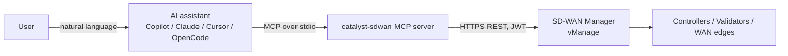

# Cisco Catalyst SD-WAN MCP Server

A [Model Context Protocol (MCP)](https://modelcontextprotocol.io/) server for **Cisco Catalyst SD-WAN Manager (vManage)**. It lets AI assistants such as OpenChamber/OpenCode, GitHub Copilot in VS Code and Visual Studio, Cursor and Claude query the SD-WAN fabric in natural language: devices, control plane, OMP, BFD, routing, templates, policies, alarms and the rest of the vManage REST API.

All requests go through vManage. The server never connects to routers directly.

- **86 MCP tools**: 82 purpose-built tools, including fabric-wide health, BFD and TLOC checks in a single call, UX 2.0 configuration groups, feature profiles and policy and topology groups, plus 4 general tools that reach **every operation in the vManage OpenAPI spec** (4,128 operations on 26.2).
- **Read-only by default.** Operations that change configuration or state are disabled unless you enable them, and each call then needs explicit confirmation.
- **Validated against the spec.** Calls through the general tools are checked against the OpenAPI spec published by *your* vManage before they are sent.
- **Secrets are protected.** Endpoints that issue tokens, passwords, OTPs or credentials are blocked. Session IDs and CSRF tokens are redacted from responses.
- **Fast and resilient.**
  - Logs in, loads the device list and the API spec in the background at startup, so the first question doesn't wait.
  - Reuses connections and shares one login across concurrent calls; the JWT is renewed in the background before it expires.
  - Combines identical concurrent requests and caps how many run against vManage at once.
  - Retries dropped connections and 429/502/503/504 with jittered backoff, honouring `Retry-After`.
  - Fails fast for 10 s after vManage proves unreachable, instead of every call waiting for a timeout.
  - Caches the API spec on disk and short-lived lookups in a bounded memory cache.
  - Returns compact JSON, and every list tool accepts `fields` and `filter` to return only what is needed.
- **Device names work everywhere.** Pass a hostname (`Branch-1`), system IP, UUID or serial number.
- **JWT authentication** (vManage 20.18.1+) with session-cookie fallback for older releases.



---

## Contents

- [What you can achieve](#what-you-can-achieve)
- [Quick start](#quick-start)
- [Versions and compatibility](#versions-and-compatibility)
- [Supported functionality](#supported-functionality)
  - [General API tools](#general-api-tools-full-vmanage-api)
  - [Dedicated tools (full reference)](#dedicated-tools)
- [Installation](#installation)
- [Configuration](#configuration)
- [Integrating with MCP clients](#integrating-with-mcp-clients)
  - [OpenChamber / OpenCode](#openchamber--opencode)
  - [Visual Studio Code (GitHub Copilot)](#visual-studio-code-github-copilot)
  - [Visual Studio 2022](#visual-studio-2022)
  - [Cursor](#cursor)
  - [Claude Desktop](#claude-desktop)
  - [Claude Code](#claude-code)
  - [Windsurf](#windsurf)
  - [Docker](#docker)
- [Examples](#examples)
- [Security](#security)
- [Testing and verification](#testing-and-verification)
- [Troubleshooting](#troubleshooting)
- [Project structure](#project-structure)
- [License](#license)

---

## What you can achieve

Ask questions about your SD-WAN fabric in plain language and get answers built from live Manager data, without clicking through the GUI or writing API scripts.

| Use case | Example questions | Main tools |
|---|---|---|
| **Inventory and health** | "Is my fabric healthy?" "How many devices are in the fabric, and are they all reachable?" | `get_fabric_health`, `list_devices`, `list_reachable_devices` |
| **Control-plane troubleshooting** | "Why is this edge missing control connections? Show the history." | `get_control_connections`, `get_control_connections_history`, `get_control_local_properties` |
| **Overlay routing (OMP)** | "Which TLOCs and routes does this site advertise in VPN 10?" | `get_omp_routes`, `get_omp_tlocs`, `get_omp_peers` |
| **Data plane and transport** | "Are all BFD sessions in the fabric up? How many TLOCs does site 100 have?" | `get_fabric_bfd_status`, `get_fabric_tlocs`, `get_bfd_sessions`, `get_control_wan_interfaces` |
| **Application-aware routing** | "Show tunnel loss/latency/jitter and SLA classes." | `get_app_route_statistics`, `get_app_route_sla_class` |
| **Configuration audit (UX 2.0)** | "Which configuration group configures the branch sites? What would a deploy change?" | `list_config_groups`, `get_config_group`, `preview_config_group_device_config` |
| **Templates and policies (UX 1.0)** | "Which device templates and centralized policies are in use?" | `list_device_templates`, `get_attached_devices`, `list_policies` |
| **Operations** | "Any critical alarms? Certificates expiring? Is the Manager cluster healthy?" | `list_alarms`, `get_certificate_summary`, `get_cluster_status` |
| **Anything else in the API** | "Show OSPF neighbors", "show IPsec/IKE sessions", "audit log for today" | `search_api_operations` → `describe_api_operation` → `call_api_operation` |
| **Controlled changes (opt-in)** | Any POST/PUT/DELETE operation, only after you approve it | `call_api_operation` with `confirm: true` and `VMANAGE_ALLOW_WRITE=true` |

---

## Quick start

```bash
# 1. Get the code and build it
git clone https://github.com/waqasdaar/cisco-catalyst-sdwan-mcp.git
cd cisco-catalyst-sdwan-mcp
npm ci && npm run build

# 2. Point it at your Manager
cp .env.example .env && chmod 600 .env
#    edit .env: VMANAGE_HOST, VMANAGE_USERNAME, VMANAGE_PASSWORD

# 3. (Optional) Smoke test with the MCP Inspector
npx @modelcontextprotocol/inspector node build/index.js
```

4. Register the server in your AI client, for example VS Code `.vscode/mcp.json`:

   ```json
   {
     "servers": {
       "catalyst-sdwan": { "type": "stdio", "command": "node", "args": ["${workspaceFolder}/build/index.js"] }
     }
   }
   ```

5. Open the chat in **Agent** mode and ask: *"How many devices are in my SD-WAN fabric?"*

See [Installation](#installation), [Configuration](#configuration) and [Integrating with MCP clients](#integrating-with-mcp-clients) for details and other clients.

---

## Versions and compatibility

| Component | Version | Notes |
|---|---|---|
| MCP server | **1.0.0** | `package.json` version, reported in the MCP `initialize` response |
| Catalyst SD-WAN Manager | **Tested on 26.2.1** | Controllers 26.2.1, WAN edges Catalyst 8000V IOS XE 26.02.01 |
| Catalyst SD-WAN Manager (auth) | 20.18.1+ for JWT | Older releases: set `VMANAGE_USE_JWT=false` (session cookie + XSRF token) |
| Node.js | 18+ to run the server; 20.12+ for the test/verification scripts | Tested on Node.js 26 |
| MCP TypeScript SDK | `@modelcontextprotocol/sdk` ^1.0.4 | Tested with 1.27.1 |
| Transport | stdio | The client starts the server as a child process |
| MCP clients tested | OpenChamber 2.5 (bundled OpenCode 2.0.32), OpenCode 1.19 | Other clients use their documented standard MCP config |

The four general API tools (`list_api_categories`, `search_api_operations`, `describe_api_operation`, `call_api_operation`) download the OpenAPI spec that your vManage publishes at `https://<vmanage>/apidocs/vmanageapi.json`. They therefore follow the API of whatever release you connect to, and new endpoints in later releases are available without code changes.

---

## Supported functionality

### General API tools (full vManage API)

| Tool | Purpose | Key parameters | Example prompt |
|---|---|---|---|
| `list_api_categories` | Lists the API categories (390 on 26.2) with counts of read, write and blocked operations | `filter` | "Which API categories exist for monitoring?" |
| `search_api_operations` | Finds operations by keywords matched against path, operationId, category and summary | `query`, `category`, `method` (`GET`/`POST`/`PUT`/`DELETE`), `access` (`read`/`write`/`blocked`), `limit` (default 25, max 100) | "Find the API for OSPF neighbors." |
| `describe_api_operation` | Shows an operation's documented parameters, request-body schema/example and access level | `operation_id`\* | "What parameters does `createOSPFNeighbors` take?" |
| `call_api_operation` | Calls any operation; parameters and body are validated against the spec | `operation_id`\*, `path_params`, `query`, `body`, `confirm`, `max_items` (default 200) | "Show OSPF neighbors on Branch-1." |

Each of the 4,128 operations in the 26.2 spec falls into one of three access levels:

| Access | Count on 26.2 | Behaviour |
|---|---|---|
| **read** | 2,392 | Runs immediately |
| **write** | 1,672 | Disabled unless `VMANAGE_ALLOW_WRITE=true`; then each call also needs `confirm: true` |
| **blocked** | 64 | Never callable: issues or exposes tokens, passwords, OTPs, credentials or bootstrap configs; file uploads; event streams |

Operations count as **write** when their method is POST, PUT or DELETE, or when their operationId or spec description describes an action. Examples: `setvSmartMtHubList` (pushes the serial list to controllers), `reTriggerNetworkMigration`, telemetry opt-in. vManage has several GET endpoints like these that change state.

### Dedicated tools

Parameters marked `*` are required; all others are optional. Every `device_id` / `device` parameter accepts a **hostname** (e.g. `Branch-1`), **system IP**, UUID or serial number. Real-time device tools query the device through the Manager; tools with `synced` can return the Manager's cached copy instead, which is faster.

**Response shaping (all tools except the three API catalog tools).** Two optional arguments trim list results before they reach the assistant, which means fewer tokens and faster answers:

| Argument | Example | Effect |
|---|---|---|
| `fields` | `["host-name", "system-ip", "reachability"]` | Keep only these fields in each row |
| `filter` | `{ "reachability": "unreachable" }` or `{ "color": ["mpls", "private1"] }` | Keep only matching rows (case-insensitive; an array matches any value). The response includes `selection: { matched, of }`. |

```json
{ "name": "list_devices", "arguments": { "fields": ["host-name", "system-ip"], "filter": { "device-type": "vedge" } } }
```

#### Fabric-wide (3)

One call answers a fabric-wide question. The server queries every selected WAN edge in parallel (bounded by `VMANAGE_MAX_CONCURRENCY`) and returns a summary plus per-device detail, instead of the assistant calling a per-device tool once per edge. Unreachable edges are listed under `skippedUnreachable` rather than queried, and a device that fails is reported with an `error` without failing the whole call.

| Tool | Description | Key parameters | Example prompt |
|---|---|---|---|
| `get_fabric_health` | Device counts per type with unreachable devices, control-connection and OMP status, reachability per device class, active alarms by severity, certificate status and Manager cluster health | – | "Is my SD-WAN fabric healthy?" |
| `get_fabric_bfd_status` | BFD sessions of every WAN edge: per-device counts, the sessions that are not up, and fabric totals | `site_id`, `devices` (hostnames or system IPs), `synced` (default `true`) | "Are all BFD sessions in the fabric up?" |
| `get_fabric_tlocs` | TLOCs of every WAN edge: color, interface, state and IPs per device, totals per color and TLOCs that are not up | `site_id`, `devices`, `synced` (default `true`) | "How many TLOCs does each branch have, and are any down?" |

The fabric BFD and TLOC tools use vManage's cached (synced) data by default. Set `synced: false` for a real-time query of every device; vManage processes many real-time device queries slowly, so combine it with `site_id` or `devices`.

#### Devices and inventory (5)

| Tool | Description | Key parameters | Example prompt |
|---|---|---|---|
| `list_devices` | All fabric devices (Manager, Controllers, Validators, WAN edges) with hostname, type, system IP, site ID, reachability and version | `model` (e.g. `vedge-C8000V`, `vsmart`) | "How many devices are in the SD-WAN fabric?" |
| `get_device_details` | Full inventory record of one device | `device_id`\* | "Show details of Branch-1." |
| `list_reachable_devices` | Devices that are currently reachable | – | "Which devices are reachable right now?" |
| `list_controllers` | Manager, Controller and Validator inventory | – | "List the controllers and their versions." |
| `list_vedge_inventory` | WAN edge authorized list with certificate and validity status | – | "Which WAN edges are in the inventory but not valid?" |

#### Control plane (13)

| Tool | Description | Key parameters | Example prompt |
|---|---|---|---|
| `get_control_connections` | Control connections of a device to Controllers, Validator and Manager | `device_id`\*, `peer_type` (`vedge`/`vsmart`/`vmanage`/`vbond`), `system_ip`, `synced` | "Show Branch-1's control connections to the vSmarts." |
| `get_control_connections_history` | Past connection attempts, errors and down reasons | `device_id`\* | "Why did Branch-2 lose its control connections?" |
| `get_control_local_properties` | System IP, site ID, organization, certificate state, Validator address, max controllers | `device_id`\*, `synced` | "What org name and certificate state does Hub-1 have?" |
| `get_control_wan_interfaces` | Per-TLOC control state: color, interface, public/private IP and port, controller counts | `device_id`\*, `synced` | "How many TLOCs does Branch-1 have?" |
| `get_control_valid_devices` | Authorized device lists held by a Controller (vSmart) | `device_id`\* (controller), `list` (`devices`/`vsmarts`/`vmanage_id`) | "Which edges are authorized on the first Controller?" |
| `get_control_affinity` | Controller-group affinity configuration or status | `device_id`\*, `type` (`config`/`status`) | "Show controller affinity status of Hub-1." |
| `get_control_links` | Fabric-wide control links in a given state | `state`\* (`up`/`down`) | "List all control links that are down." |
| `get_control_status` | Fabric-wide control up/down counts | – | "How many control connections are up vs. down?" |
| `get_control_count` | Control connection counts, fabric-wide or per site | `site_id` | "Control connection count for site 103." |
| `get_control_network_summary` | Per device: control connections, OMP peers, vSmart peers, reachability | `state` (`up`/`down`) | "Give me a fabric-wide control-plane summary." |
| `get_network_connections_summary` | Reachable/unreachable counts per device class | – | "How many WAN edges are unreachable?" |
| `get_control_summary` | Control-plane summary of a device | `device_id`\* | "Control summary of Branch-3." |
| `get_control_statistics` | DTLS control connection statistics | `device_id`\* | "Show DTLS statistics of Branch-1." |

#### OMP – Overlay Management Protocol (9)

| Tool | Description | Key parameters | Example prompt |
|---|---|---|---|
| `get_omp_peers` | OMP peers of a device | `device_id`\*, `synced` | "Show the OMP peers of the first Controller." |
| `get_omp_routes` | OMP routes received or advertised | `device_id`\*, `direction` (`received`/`advertised`), `vpn_id`, `prefix` | "Show OMP routes Branch-1 receives in VPN 10." |
| `get_omp_tlocs` | OMP TLOC routes received or advertised | `device_id`\*, `direction`, `color` | "Which TLOCs does Branch-1 advertise?" |
| `get_omp_services` | OMP service routes (VPN, firewall, IDS, ...) | `device_id`\* | "Which OMP services does Hub-1 know?" |
| `get_omp_multicast` | Multicast routes or auto-discovery entries | `device_id`\*, `type` (`routes`/`autodiscover`), `direction` | "Show multicast auto-discovery on Branch-2." |
| `get_omp_cloudx` | Cloud OnRamp (CloudExpress) OMP routes | `device_id`\* | "Any Cloud OnRamp routes on Hub-1?" |
| `get_omp_links` | Fabric-wide OMP peering links in a given state | `state`\* (`up`/`down`) | "List OMP peerings that are down." |
| `get_omp_status` | Fabric-wide OMP up/down counts | – | "Are all OMP peerings up?" |
| `get_omp_summary` | OMP summary of a device | `device_id`\* | "OMP summary of Branch-3." |

#### Validator – vBond / orchestrator (6)

Use the Validator's system IP or hostname as `device_id`.

| Tool | Description | Key parameters | Example prompt |
|---|---|---|---|
| `get_validator_connections` | Current connections on the Validator, or history | `device_id`\*, `history` | "Show the Validator's connection history." |
| `get_validator_summary` | Validator connection summary | `device_id`\* | "Validator connection summary." |
| `get_validator_statistics` | DTLS/control packet statistics | `device_id`\* | "Show Validator packet statistics." |
| `get_validator_local_properties` | Organization, certificate state, system IP | `device_id`\* | "Which organization name is the Validator using?" |
| `get_validator_valid_devices` | Authorized device lists on the Validator | `device_id`\*, `list` (`vedges`/`vsmarts`/`vmanage_id`) | "How many WAN edges are authorized on the Validator?" |
| `get_validator_proxy_mapping` | NAT/proxy mapping table | `device_id`\* | "Show the Validator NAT mapping table." |

#### Data plane, interfaces, routing and system (12)

| Tool | Description | Key parameters | Example prompt |
|---|---|---|---|
| `get_bfd_sessions` | BFD sessions (tunnels) of a device | `device_id`\*, `synced` | "Are all BFD sessions on Branch-1 up?" |
| `get_bfd_summary` | BFD session summary | `device_id`\* | "BFD summary of Branch-2." |
| `get_bfd_tloc` | BFD session summary per TLOC | `device_id`\* | "BFD sessions per TLOC color on Branch-3." |
| `get_device_tloc` | TLOC information of a device | `device_id`\* | "Show TLOCs of Branch-1." |
| `get_device_vpn` | VPN configuration of a device | `device_id`\* | "Which VPNs are configured on Hub-2?" |
| `get_bridge_table` | Bridge forwarding table | `device_id`\* | "Show the bridge table of Branch-2." |
| `get_device_interfaces` | Interface status and configuration | `device_id`\*, `synced` | "Which interfaces are down on Branch-3?" |
| `get_device_arp` | ARP table (IPv4 to MAC) | `device_id`\* | "Show the ARP table of Hub-1." |
| `get_system_status` | CPU, memory, uptime | `device_id`\*, `synced` | "What's the CPU and memory usage on Hub-1?" |
| `get_bgp_neighbors` | BGP neighbors | `device_id`\* | "Show BGP neighbors on Hub-1." |
| `get_bgp_routes` | BGP routes | `device_id`\* | "Show BGP routes on Hub-2." |
| `get_bgp_summary` | BGP summary | `device_id`\* | "BGP summary of Hub-1." |

#### Application-aware routing, flows and statistics (7)

| Tool | Description | Key parameters | Example prompt |
|---|---|---|---|
| `get_app_route_statistics` | AAR tunnel statistics (loss, latency, jitter) | `device_id`\* | "Show tunnel loss and latency on Branch-1." |
| `get_app_route_sla_class` | SLA classes used by application-aware routing | `device_id`\* | "Which SLA classes are configured on Branch-1?" |
| `get_cflowd_flows` | cFlowd flow records | `device_id`\* | "Show cFlowd flows on Branch-3." |
| `get_cflowd_statistics` | cFlowd packet statistics | `device_id`\* | "cFlowd statistics of Branch-3." |
| `get_app_log_flows` | Packet flow logs | `device_id`\* | "Show logged flows on Branch-2." |
| `get_app_log_flow_count` | Number of logged flows | `device_id`\* | "How many flows are being logged on Branch-2?" |
| `get_sdwan_stats` | SD-WAN statistics: ACL drops, data policy, device metrics | `device_id`\* | "Any data-policy drops on Branch-2?" |

#### UX 2.0 configuration (12)

The `solution` parameter selects `sdwan` (default), `sd-routing`, `nfvirtual` or `mobility`. Groups and profiles can be passed by ID or exact name.

| Tool | Description | Key parameters | Example prompt |
|---|---|---|---|
| `get_ux2_overview` | One-call summary: configuration, policy and topology groups with device counts and deployment state, plus feature-profile counts per type | `solution` | "Are any configuration groups out of sync or failed?" |
| `list_config_groups` | Configuration groups with feature profiles, device counts and deployment state | `solution`, `name` | "How many configuration groups are on vManage?" |
| `get_config_group` | One configuration group with its profiles and associated devices | `config_group`\* | "Which devices does configuration group Branch-CG configure?" |
| `get_config_group_device_variables` | Device-specific variable values (all devices or one) | `config_group`\*, `device` | "Show the variables of Branch-1 in Branch-CG." |
| `preview_config_group_device_config` | **Read-only** preview: configuration the group would push vs. running config. Nothing is deployed. | `config_group`\*, `device`\*, `view` (`diff` default/`new`/`existing`/`both`) | "What would Branch-CG change on Branch-1 if I deployed now?" |
| `list_policy_groups` | Policy groups with profiles, device counts and state | `solution` | "List the policy groups." |
| `get_policy_group` | One policy group with profiles and devices | `policy_group`\* | "Which devices use policy group Branch-PG?" |
| `list_topology_groups` | Topology groups (hub-and-spoke, mesh) | `solution` | "Which topology groups exist?" |
| `get_topology_group` | One topology group with its profiles | `topology_group`\* | "Show topology group Hub-Spoke." |
| `list_feature_profiles` | Feature profiles per type (`system`, `transport`, `service`, `cli`, `policy-object`, `application-priority`, ...) | `solution`, `profile_type` | "List all transport profiles." |
| `get_feature_profile` | One profile with its features (parcels) | `profile_type`\*, `profile`\*, `solution` | "Show the features in the Hub-Transport profile." |
| `get_network_hierarchy` | Global, regions, areas and sites | – | "Show the network hierarchy." |

#### Templates and policy – UX 1.0 (7)

| Tool | Description | Key parameters | Example prompt |
|---|---|---|---|
| `list_device_templates` | Device (master) templates | `feature` (`all`/`lawful-interception`/`cloud-dock`/`network-design`/`vmanage-default`) | "List the device templates." |
| `list_feature_templates` | Feature templates | – | "How many feature templates exist?" |
| `get_attached_devices` | Devices attached to a device template | `template_id`\* | "Which devices use template X?" |
| `get_template_definition` | Definition of a device or feature template | `template_id`\*, `template_type`\* (`device`/`feature`) | "Show the definition of device template X." |
| `list_policy_lists` | Policy lists (app, color, prefix, site, SLA, TLOC, VPN, ...) | `list_type` | "Show all site lists." |
| `list_policy_definitions` | Policy definitions of one type | `definition_type`\* (`acl`, `approute`, `control`, `data`, `hubandspoke`, `mesh`, `qosmap`, `zonebasedfw`, ...) | "List the app-route policy definitions." |
| `list_policies` | Centralized (vSmart), localized (vEdge) and security policies | `policy_type` (`vsmart`/`vedge`/`security`) | "Which centralized policy is active?" |

#### Cloud OnRamp, administration and applications (8)

| Tool | Description | Key parameters | Example prompt |
|---|---|---|---|
| `get_cloudx_status` | Cloud OnRamp for SaaS: sites per application | – | "Cloud OnRamp status for Office 365." |
| `get_cloudx_gateway_list` | Cloud OnRamp gateway sites | – | "Which sites are Cloud OnRamp gateways?" |
| `get_cloudx_client_list` | Cloud OnRamp client sites | – | "Which sites are Cloud OnRamp clients?" |
| `get_cloudx_apps` | Cloud OnRamp applications and VPNs | – | "Which SaaS apps are enabled for Cloud OnRamp?" |
| `list_alarms` | Active alarms | `limit` (default 100), `site_id` | "Any active alarms for site 103?" |
| `get_certificate_summary` | Certificate validity summary | – | "Are any certificates about to expire?" |
| `get_cluster_status` | Manager cluster health per node | – | "Is the vManage cluster healthy?" |
| `list_custom_apps` | Custom application definitions | – | "List the custom applications." |

Anything without a dedicated tool, such as OSPF, EIGRP, NAT, IPsec/IKE, QoS, multicast, cellular, UTD, statistics or the audit log, is available through `search_api_operations` and `call_api_operation`.

---

## Installation

Prerequisites: Node.js 18+ (20.12+ for the test scripts), npm, and HTTPS access to Catalyst SD-WAN Manager.

```bash
git clone https://github.com/waqasdaar/cisco-catalyst-sdwan-mcp.git
cd cisco-catalyst-sdwan-mcp
npm ci
cp .env.example .env        # then edit .env (see Configuration)
npm run build
```

Check that it starts. Press `Ctrl+C` to stop it:

```bash
npm start
# stderr: Cisco Catalyst SD-WAN MCP Server running on stdio
```

The command your MCP client will run is:

```bash
node /absolute/path/to/catalyst-sdwan-mcp-community/build/index.js
```

### Recommended: deploy outside cloud-synced folders

If the project is in OneDrive, iCloud Drive, Dropbox or Google Drive, the sync client can move files to the cloud and the server then fails with `ETIMEDOUT` when it starts. Deploy a runtime copy instead:

```bash
npm run deploy
# Deployed to ~/mcp-servers/catalyst-sdwan-mcp
# MCP command: node ~/mcp-servers/catalyst-sdwan-mcp/build/index.js
```

`npm run deploy` builds the server and copies `build/`, `.env` (permissions `600`) and the production dependencies to `~/mcp-servers/catalyst-sdwan-mcp`. Set `CATALYST_SDWAN_MCP_HOME` to use another folder. Run it again after every code or `.env` change, then restart your MCP client.

---

## Configuration

The server reads `.env` from the project (or deployed) root folder. You can also pass the variables through your MCP client's `env` settings. Values the client sets take precedence over `.env`.

| Variable | Required | Default | Description |
|---|---|---|---|
| `VMANAGE_HOST` | Yes | | Manager hostname or IP (no `https://`) |
| `VMANAGE_USERNAME` | Yes | | API user |
| `VMANAGE_PASSWORD` | Yes | | API password |
| `VMANAGE_PORT` | No | `443` | HTTPS port |
| `VMANAGE_USE_JWT` | No | `true` | `false` uses session-cookie auth (Manager releases before 20.18.1) |
| `VMANAGE_ALLOW_WRITE` | No | `false` | `true` allows write operations through `call_api_operation` (each still needs `confirm: true`) |
| `VMANAGE_TIMEOUT_MS` | No | `120000` | Per-request timeout. Real-time device queries are proxied through the Manager and can be slow. |
| `VMANAGE_MAX_CONCURRENCY` | No | `8` | Maximum simultaneous requests sent to the Manager |
| `VMANAGE_LOG_TIMING` | No | `false` | `true` logs each vManage call (path, status, duration, retries, cache hits) to stderr. Never logs credentials or response data. |

The OpenAPI spec is cached in `~/.cache/catalyst-sdwan-mcp/` for 24 hours. If the Manager is unreachable, an older cached copy is used. Delete the file to force a refresh after an upgrade.

```dotenv
VMANAGE_HOST=vmanage.example.com
VMANAGE_USERNAME=mcp-readonly
VMANAGE_PASSWORD=change-me
VMANAGE_PORT=443
VMANAGE_USE_JWT=true
VMANAGE_ALLOW_WRITE=false
```

Use a dedicated Manager account. A read-only user group such as `operator` is enough unless you plan to enable writes.

---

## Integrating with MCP clients

In every example below, replace `/absolute/path/to/build/index.js` with your path:
- `~/mcp-servers/catalyst-sdwan-mcp/build/index.js` (expanded) if you used `npm run deploy`
- otherwise `<project>/build/index.js`

On Windows use forward slashes (`C:/mcp/catalyst-sdwan-mcp/build/index.js`) or escaped backslashes in JSON. Clients do not expand `~`, so always give the full path.

### OpenChamber / OpenCode

[OpenChamber](https://github.com/openchamber/openchamber) runs on [OpenCode](https://opencode.ai/), so MCP servers are configured in OpenCode's config. The desktop app bundles OpenCode 2.

1. Add the server to a project config (`opencode.json` in the folder you open in OpenChamber) or to the global config (`~/.config/opencode/opencode.json`).

   **OpenCode 2.x (OpenChamber 2.x)**: servers go under `mcp.servers`:

   ```json
   {
     "$schema": "https://opencode.ai/config.json",
     "mcp": {
       "servers": {
         "catalyst-sdwan": {
           "type": "local",
           "command": ["node", "/absolute/path/to/build/index.js"],
           "timeout": { "startup": 60000 }
         }
       }
     }
   }
   ```

   Or add it from the CLI. Add `--global` to make it available in every project:

   ```bash
   opencode mcp add catalyst-sdwan -- node /absolute/path/to/build/index.js
   ```

   **OpenCode 1.x**: servers go directly under `mcp` and use `enabled`:

   ```json
   {
     "$schema": "https://opencode.ai/config.json",
     "mcp": {
       "catalyst-sdwan": {
         "type": "local",
         "command": ["node", "/absolute/path/to/build/index.js"],
         "enabled": true,
         "timeout": 60000
       }
     }
   }
   ```

2. Restart OpenChamber completely (macOS: `Cmd+Q`, then reopen).
3. Verify with `/mcps` in a session, or from a terminal in the project folder. Use the OpenCode CLI that matches your OpenChamber; the desktop app's copy on macOS is:

   ```bash
   /Applications/OpenChamber.app/Contents/Resources/opencode-cli/opencode mcp list
   # ✓ catalyst-sdwan   connected
   ```

The message *"This file still uses the OpenCode 1 format"* means the config uses the 1.x layout. Move the server under `mcp.servers` as shown above.

### Visual Studio Code (GitHub Copilot)

Requires VS Code with GitHub Copilot Chat in **Agent** mode.

1. Create `.vscode/mcp.json` in your workspace for a single project, or run **MCP: Open User Configuration** from the Command Palette for all workspaces:

   ```json
   {
     "servers": {
       "catalyst-sdwan": {
         "type": "stdio",
         "command": "node",
         "args": ["/absolute/path/to/build/index.js"]
       }
     }
   }
   ```

   To keep the password out of files, let VS Code prompt for it. Values in `env` override `.env`:

   ```json
   {
     "inputs": [
       { "type": "promptString", "id": "vmanage-password", "description": "vManage password", "password": true }
     ],
     "servers": {
       "catalyst-sdwan": {
         "type": "stdio",
         "command": "node",
         "args": ["/absolute/path/to/build/index.js"],
         "env": {
           "VMANAGE_HOST": "vmanage.example.com",
           "VMANAGE_USERNAME": "mcp-readonly",
           "VMANAGE_PASSWORD": "${input:vmanage-password}"
         }
       }
     }
   }
   ```

   If the server lives in the workspace you have open, you can use a relative path. The server then reads `.env` from the project root:

   ```json
   {
     "servers": {
       "catalyst-sdwan": {
         "type": "stdio",
         "command": "node",
         "args": ["${workspaceFolder}/build/index.js"]
       }
     }
   }
   ```

   Alternatively, from a terminal:

   ```bash
   code --add-mcp '{"name":"catalyst-sdwan","command":"node","args":["/absolute/path/to/build/index.js"]}'
   ```

2. Start the server: open `mcp.json` and click **Start** above the server, or run **MCP: List Servers**.
3. In Copilot Chat, switch to **Agent** mode, open the tools picker and make sure the `catalyst-sdwan` tools are enabled.

### Visual Studio 2022

Requires Visual Studio 2022 17.14 or later with GitHub Copilot.

1. Create `.mcp.json` in your solution folder, or `%USERPROFILE%\.mcp.json` for all solutions:

   ```json
   {
     "servers": {
       "catalyst-sdwan": {
         "type": "stdio",
         "command": "node",
         "args": ["C:/mcp/catalyst-sdwan-mcp/build/index.js"]
       }
     }
   }
   ```

2. Open **GitHub Copilot Chat**, select **Agent** mode, click the tools icon and enable the `catalyst-sdwan` tools.

### Cursor

1. Edit `~/.cursor/mcp.json` (all projects) or `.cursor/mcp.json` (one project), or use **Settings → MCP → Add new MCP server**:

   ```json
   {
     "mcpServers": {
       "catalyst-sdwan": {
         "command": "node",
         "args": ["/absolute/path/to/build/index.js"]
       }
     }
   }
   ```

   Optionally add `"env": { "VMANAGE_HOST": "...", ... }` instead of using `.env`.

2. Open **Settings → MCP** and check that `catalyst-sdwan` shows a green status and lists its tools.
3. Use the tools from the Agent chat.

### Claude Desktop

1. Open **Settings → Developer → Edit Config**, or edit the file directly:
   - macOS: `~/Library/Application Support/Claude/claude_desktop_config.json`
   - Windows: `%APPDATA%\Claude\claude_desktop_config.json`

   ```json
   {
     "mcpServers": {
       "catalyst-sdwan": {
         "command": "node",
         "args": ["/absolute/path/to/build/index.js"]
       }
     }
   }
   ```

2. Restart Claude Desktop. The tools appear under the tools (hammer) icon in the chat box.

### Claude Code

```bash
claude mcp add catalyst-sdwan --scope user -- node /absolute/path/to/build/index.js
claude mcp list
```

### Windsurf

Edit `~/.codeium/windsurf/mcp_config.json`, then refresh the MCP servers in Cascade:

```json
{
  "mcpServers": {
    "catalyst-sdwan": {
      "command": "node",
      "args": ["/absolute/path/to/build/index.js"]
    }
  }
}
```

### Docker

Build the image:

```bash
docker build -t catalyst-sdwan-mcp:latest .
```

MCP clients start the container per session over stdio. Pass the settings with `--env-file`; the image never contains `.env`. Example for Cursor or Claude Desktop:

```json
{
  "mcpServers": {
    "catalyst-sdwan": {
      "command": "docker",
      "args": ["run", "-i", "--rm", "--env-file", "/absolute/path/to/.env", "catalyst-sdwan-mcp:latest"]
    }
  }
}
```

For VS Code, use the same `command`/`args` with `"type": "stdio"`. For OpenCode, use `"command": ["docker", "run", "-i", "--rm", "--env-file", "/absolute/path/to/.env", "catalyst-sdwan-mcp:latest"]`.

---

## Examples

### Sample session

Representative answers from a lab fabric (Manager 26.2.1, Catalyst 8000V edges). Names and addresses are anonymized.

**"How many devices are in the SD-WAN fabric?"** → `list_devices`

| Type | Count | Reachable |
|---|---|---|
| vManage | 1 | 1 |
| vSmart | 2 | 2 |
| vBond | 1 | 1 |
| WAN edge | 13 | 13 |

Total: 17 devices, all reachable.

**"List the total number of TLOCs on Branch-1."** → `get_control_wan_interfaces`, `get_omp_tlocs`

| Color | Interface | Encap | State |
|---|---|---|---|
| `private1` | GigabitEthernet1 | IPsec | up |
| `mpls` | GigabitEthernet2 | IPsec | up |

Total: 2 TLOCs, each advertised over OMP to both Controllers.

**"How many configuration groups are on vManage, and which one configures the branch sites?"** → `list_config_groups`, `get_config_group`

6 configuration groups. Example mapping:

| Sites | Configuration group |
|---|---|
| Hub-1, Hub-2 | Hub-CG |
| Branch-1, Branch-2 | Branch-CG (added by tag rule) |

### Natural-language prompts

| Ask your assistant | Tools it uses |
|---|---|
| "List all SD-WAN devices with hostname, type, model, system IP, site ID, reachability and version." | `list_devices` |
| "Give me an overview of the UX 2.0 configuration: which configuration groups are out of sync or failed?" | `get_ux2_overview` |
| "Which devices are in configuration group *Branch-CG*, and what are their variable values?" | `get_config_group`, `get_config_group_device_variables` |
| "What would configuration group *Branch-CG* change on *Branch-1* if I deployed it now?" | `preview_config_group_device_config` |
| "Show the features in the *Branch-Transport* transport profile." | `get_feature_profile` |
| "Which devices are unreachable, and what do their control connection histories show?" | `list_devices`, `get_control_connections_history` |
| "Show the OMP routes that Branch-1 receives in VPN 10." | `get_omp_routes` (`vpn_id: "10"`) |
| "Which TLOCs does Branch-1 advertise, and are its BFD sessions up?" | `get_omp_tlocs`, `get_bfd_sessions` |
| "Give me a fabric-wide control-plane summary: control connections and OMP peers per device." | `get_control_network_summary` |
| "How many WAN edges are authorized on the validator?" | `get_validator_valid_devices` |
| "Show OSPF neighbors on Branch-1." | `search_api_operations` → `call_api_operation` (`createOSPFNeighbors`) |
| "Which certificates expire soon, and are there active critical alarms?" | `get_certificate_summary`, `list_alarms` |
| "List the centralized policies and the device templates in use." | `list_policies`, `list_device_templates` |

### Tool calls (JSON arguments)

Received OMP routes in one VPN:

```json
{ "name": "get_omp_routes", "arguments": { "device_id": "Branch-1", "direction": "received", "vpn_id": "10" } }
```

Find an API operation, check its parameters, then call it:

```json
{ "name": "search_api_operations", "arguments": { "query": "ospf neighbor" } }
```

```json
{ "name": "describe_api_operation", "arguments": { "operation_id": "createOSPFNeighbors" } }
```

```json
{ "name": "call_api_operation", "arguments": { "operation_id": "createOSPFNeighbors", "query": { "deviceId": "<system-ip>" }, "max_items": 50 } }
```

Path parameters and statistics queries:

```json
{
  "name": "call_api_operation",
  "arguments": {
    "operation_id": "getMasterTemplateDefinition",
    "path_params": { "templateId": "<template-id>" }
  }
}
```

```json
{
  "name": "call_api_operation",
  "arguments": {
    "operation_id": "postDocCount_MonitoringAlarmsDetails_1604",
    "body": { "query": { "condition": "AND", "rules": [{ "field": "entry_time", "type": "date", "operator": "last_n_hours", "value": ["24"] }] } }
  }
}
```

Operation IDs can differ between Manager releases. Use `search_api_operations` to find the ID on your release.

A write operation, when `VMANAGE_ALLOW_WRITE=true`, after the user has approved it:

```json
{ "name": "call_api_operation", "arguments": { "operation_id": "<write-operation-id>", "body": { }, "confirm": true } }
```

Without `confirm: true`, or with writes disabled, the server refuses the call and explains why.

---

## Security

- **Read-only by default.** POST, PUT and DELETE operations, and GETs documented as actions, are refused unless `VMANAGE_ALLOW_WRITE=true`. Each write call then also needs `confirm: true`, which assistants should set only after the user approves.
- **Blocked endpoints.** Operations that issue or expose tokens, passwords, OTPs, credentials or bootstrap configurations are never callable. Neither are file uploads or server-sent event streams.
- **Validation.** Path and query parameters must exist in the spec, required ones must be present, and types and enums are checked. Path values are URL-encoded and `.`/`..` are rejected.
- **Redaction and limits.** Values of keys such as `password`, `token`, `csrf` and `sessionId` are replaced with `***redacted***`. List responses are capped (default 200 rows, `max_items` to change) and output stays under 200,000 characters.
- **TLS.** Certificate verification is disabled so lab Managers with self-signed certificates work. Use it only on trusted networks, and treat this as a known limitation for production.
- **Credentials.** Keep `.env` out of version control (it is in `.gitignore`), restrict its permissions (`chmod 600 .env`), and use a dedicated least-privilege Manager account.
- **Access-level detection is a heuristic.** It uses the operationId and spec description. Test against a lab Manager before you enable writes on a production fabric.

---

## Testing and verification

```bash
npm run build                 # compile TypeScript
# <edge>, <controller>, <validator>: hostname or system IP of a WAN edge, Controller and Validator in your fabric
npm run test:control-plane -- <edge> <controller> <validator>   # 39 live control-plane/OMP/validator calls + input-validation checks
npm run test:ux2 -- <edge-hostname>   # UX 2.0 tools incl. config preview, hostname resolution, parallel calls, error handling (with timings)
npm run verify:api -- <edge> <controller> <validator>   # full read-only coverage run (≈25 min) → API_COVERAGE.md + api_coverage.csv
```

`verify:api` calls every read operation that needs no IDs or input (about 1,260 on 26.2) through the real MCP server. It records the result of each operation in [API_COVERAGE.md](API_COVERAGE.md) and [api_coverage.csv](api_coverage.csv). Although it only runs read operations, it sends a large number of calls, so run it against a lab Manager. The reports replace the test device IDs and the sampled group, profile and template names with placeholders such as `<edge>` and `<config-group>`, so they can be published.

Results on Catalyst SD-WAN Manager 26.2.1:

| Item | Result |
|---|---|
| Operations in the spec | 4,128 (2,392 read / 1,672 write / 64 blocked) |
| Read operations live-tested | 1,261 |
| Returned data | 1,113 |
| Errors from Manager or lab (feature not configured, query body required, provider-only role) | 148 |
| Dedicated tools verified live | 86 / 86 (83 by `verify:api`; the 3 fabric-wide tools by `test:ux2`) |

To try individual tools interactively, use the MCP Inspector:

```bash
npx @modelcontextprotocol/inspector node /absolute/path/to/build/index.js
```

---

## Troubleshooting

| Symptom | Cause / fix |
|---|---|
| `ETIMEDOUT ... read` or the server hangs on start | Project is in a cloud-synced folder whose files were moved to the cloud. Run `npm run deploy` and point the client at `~/mcp-servers/catalyst-sdwan-mcp/build/index.js`. |
| `Cannot reach vManage at <host>:443 (ETIMEDOUT)` | No network path to the Manager (often a disconnected VPN). The server gives up after 10 s instead of hanging. Spec-based tools keep working from the cached spec. |
| A tool is missing or behaves like an old version | The client is starting a different copy of the server. Check every config the client reads: for OpenCode, both the project `opencode.json` and the global `~/.config/opencode/opencode.json(c)`. |
| Calls take ~2 s each | That is the Manager's own response time per request, even on a reused connection. Prefer the combined tools (`get_ux2_overview`, `list_feature_profiles`), which run their requests in parallel, and use `fields`/`filter` to keep responses small. Set `VMANAGE_LOG_TIMING=true` to see per-call durations. |
| `... Retrying the connection in N s.` | The previous call found vManage unreachable, so calls fail immediately for 10 s instead of each waiting for a timeout. Restore connectivity and retry. |
| OpenChamber: *"This file still uses the OpenCode 1 format"* or "No MCP servers configured" | OpenCode 2 reads only `mcp.servers.<name>`. See [OpenChamber / OpenCode](#openchamber--opencode). |
| `VMANAGE_HOST environment variable is required` | `.env` is missing next to `build/` (after deploying, run `npm run deploy` again) or the client `env` is incomplete. |
| `JWT authentication failed: 400 ... Duration must be ... <= 1800` | Fixed in this version (token duration is 1800 s). Rebuild. |
| `JWT authentication failed` on older Managers | Set `VMANAGE_USE_JWT=false`. |
| `... is disabled: write operations need VMANAGE_ALLOW_WRITE=true` | Expected in read-only mode. Enable deliberately, then `npm run deploy` and restart the client. |
| `Unknown query parameter(s)` / `Missing required ...` | The call does not match the spec. Run `describe_api_operation` for the exact parameter names. |
| `vManage API error 400 ... Empty query` | Statistics endpoints need a query body even when the spec marks it optional. See the statistics example above. |
| `truncated` in a response | The response was larger than the limit. Filter (for example `vpn_id`, `site_id`) or lower `max_items`. |
| Node warns about `NODE_TLS_REJECT_UNAUTHORIZED` | Comes from your shell environment, not this server. Remove the variable if you don't need it. |

---

## Project structure

```text
src/
  index.ts                  # entry point: loads .env, starts stdio server
  server.ts                 # MCP tool definitions and handlers
  services/vmanageApi.ts    # HTTPS client, JWT/session auth, generic request()
  services/apiCatalog.ts    # OpenAPI-driven catalog: search, describe, validated calls, access control
  utils/config.ts           # environment configuration
scripts/
  deploy.mjs                # deploy runtime copy outside cloud-synced folders
  test-control-plane.mjs    # live regression test
  test-ux2.mjs              # live UX 2.0 tools test
  verify-api-coverage.mjs   # full coverage run and report
.vscode/mcp.json            # VS Code MCP server registration
API_COVERAGE.md, api_coverage.csv   # last coverage report
Dockerfile, docker-compose.yml
```

---

## References

- [Cisco Catalyst SD-WAN Manager API](https://developer.cisco.com/docs/sdwan/overview/)
- [Authentication](https://developer.cisco.com/docs/sdwan/authentication/)
- [Device Real-Time Monitoring](https://developer.cisco.com/docs/sdwan/device-realtime-monitoring/)
- [Model Context Protocol](https://modelcontextprotocol.io/)

## License

MIT. See [LICENSE](LICENSE).

Based on the [CiscoDevNet catalyst-sdwan-mcp-community](https://github.com/CiscoDevNet/catalyst-sdwan-mcp-community) project.

[](https://lobehub.com/mcp/sdntechforum-catalyst-sdwan-mcp)
